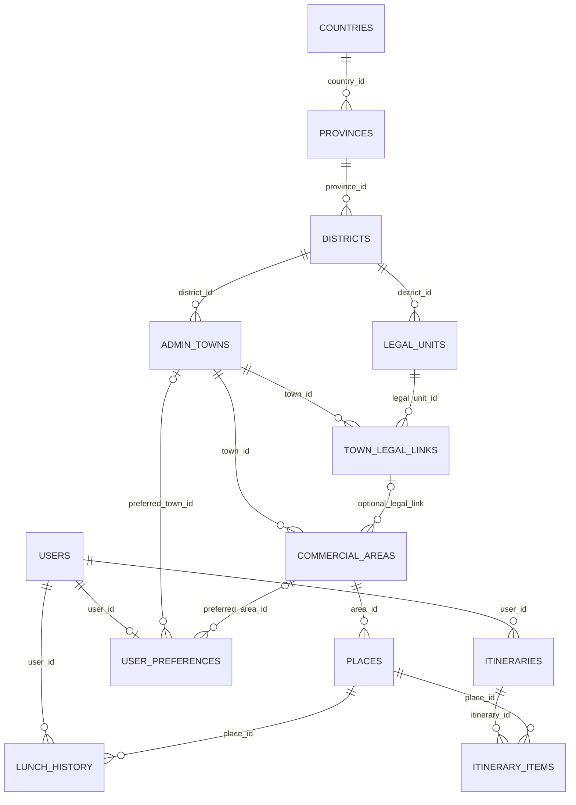

# 점심·여행 자동 결정 시스템 V8.3 — DB ERD 전면 재설계

## 결론

기존 V8.2.8에서는 동일 행정구역을 `countries/regions/cities/areas`와 `locations` 두 구조에 중복 저장하고 있으며, 상권이 `district` 바로 밑에 매달린 기존 레코드도 존재할 수 있습니다. 프런트엔드는 `district.id`의 직접 자식 `town`만 읽기 때문에, `town` 데이터가 없거나 다른 중복 `district.id`에 있으면 `읍·면·동` 선택이 비어 있습니다. **이 상태에서는 샘플을 추가했다는 것만으로 하위 선택 연결이 보장되지 않습니다.**

또한 `종로1·2·3·4가동`은 행정동이고 `종로1가`는 법정동입니다. 두 개를 `읍·면·동 → 리`로 취급하는 것은 모델링 오류입니다. 행정동과 법정동/리는 행정 경계가 정확히 일대일이 아닐 수 있으므로 별도 매핑 테이블을 둡니다.

## 새 표준 DB (데이터를 삭제하지 않음)

새 DB 이름: **`lunch_decision_v83`**. 기존 `lunch_decision`에는 CREATE/ALTER/DELETE/UPDATE하지 않습니다. 테스트를 통과한 뒤 별도 데이터 이관 및 프로그램 교체를 해야 기존 사용자 사이트에도 반영됩니다.



## 지역별 실제 FK 연결 기준

| 순서 | 테이블 | 부모 FK | 표시 예시 |
|---|---|---|---|
| 1 | `countries` | 없음 | 대한민국 |
| 2 | `provinces` | `country_id → countries.id` | 서울특별시 |
| 3 | `districts` | `province_id → provinces.id` | 종로구 |
| 4 | `admin_towns` | `district_id → districts.id` | 종로1·2·3·4가동 |
| 5(선택) | `legal_units` | `district_id → districts.id` | 종로1가(법정동) |
| 5의 연결 | `town_legal_links` | `(district_id,town_id)` + `(district_id,legal_unit_id)` 복합 FK | 실제 같은 구 안에서만 매핑 |
| 6 | `commercial_areas` | `town_id → admin_towns.id`, `(town_id,legal_unit_id) → town_legal_links` | 종각상권 |
| 7 | `places` | `area_id → commercial_areas.id` | 종각 테스트 국밥 |

`legal_unit_id`는 선택 사항입니다. 무주읍→읍내리 같은 사례에는 리를 선택하고, 사직동→광화문상권에서는 법정동 없이 곧바로 상권을 선택할 수 있습니다.

`countries`, `provinces`, `districts`, `admin_towns`는 **각 단계마다 명확한 한 개의 FK**를 갖고, 장소는 오직 `area_id`만 저장합니다. `country_id`, `region_id`, `city_id`를 장소마다 중복해서 기록하지 않습니다. `v_place_full_path` 뷰로 국가까지 조회합니다.

## 코드 정책

- 모든 테이블의 `code` 필수.
- 복합 유니크 인덱스로 부모 범위에서 중복 행정코드/지역명 방지.
- 공식 행정코드/공식 데이터라고 가장하지 않습니다. 샘플은 `D-` 코드와 테스트 이름으로 구분합니다.
- 법정동·리와 행정 읍·면·동은 별개입니다. `town_legal_links`로 다대다 매핑합니다.
- 상권은 읍면동 FK가 항상 필요하고, 법정동·리 FK는 있을 때만 연결합니다.
- 참조 중인 부모 삭제는 RESTRICT로 방지합니다.
- `users`, `preferences`, `lunch_history`, `itineraries`, `itinerary_items`도 외래키로 연결합니다.

## 사용 가능한 테스트 프로그램

- `npm run setup`: 신규 DB + 테이블 생성
- `npm run seed:demo`: 6개 연쇄 경로 + 샘플 장소 저장 (트랜잭션/반복 실행 안전)
- `npm run verify`: **실제 API와 동일한 조회 SQL**로 6개 경로와 FK 검사, `diagnostics/connection-report.json` 저장
- `npm run diagnose:old`: **기존 DB 조회 전용** 진단. 종로구/중구/무주군의 읍면동 직속 연결 누락 등 리포트 생성
- `npm start`: http://localhost:3100 실제 연쇄 선택 화면

## 화면에서 실제 사용하는 API

```
GET /api/geo/countries
GET /api/geo/provinces?country_id=...
GET /api/geo/districts?province_id=...
GET /api/geo/towns?district_id=...
GET /api/geo/legal-units?town_id=...
GET /api/geo/areas?town_id=...&legal_unit_id=...  (법정동/리 선택은 생략 가능)
GET /api/geo/places?area_id=...
GET /api/geo/path?area_id=...
GET /api/geo/summary
GET /health
```

자식 단계에는 항상 직전 단계의 FK를 전달합니다. 자식이 없으면 0건이라고 명확히 안내하고, 이전 단계의 선택이 바뀌면 하위 항목들을 모두 초기화합니다.

## 기존 시스템과 연결하는 방식 (운영 이전 단계)

1. 기존 DB **백업** → `npm run diagnose:old`로 원인 보고서 추출.
2. 별도 `lunch_decision_v83` 생성/샘플 → `npm run verify` 성공 확인.
3. 구 시스템 `countries,regions,cities,areas`를 새 테이블에 직접 덮어쓰지 말고 `old_id ↔ new_id` 이관 매핑 테이블과 명확한 이름/코드 대조표를 작성.
4. **행정동/법정동 코드 공식 원천 데이터** 적재 후 `town_legal_links` 수동/공식 매핑 검증.
5. 음식점·관광지 장소는 이관된 `commercial_areas.id`에 FK로 연결하고 불일치 목록은 보류.
6. 사용자 화면·관리자 화면을 새 `/api/geo/...` 계약으로 통일. 추천/여행 서비스도 `places` 단일 구조 사용하도록 단계적 교체.
7. 이관 전후 레코드 수/누락 FK/전체 경로/회원·방문기록 검사 후 실제 사용.

**이 패키지만 실행한다고 기존 localhost:3000 페이지가 자동으로 고쳐지는 것은 아닙니다.** 다른 DB로 분리하여 ERD와 연결을 먼저 확실히 검증하는 것이 목적입니다.
