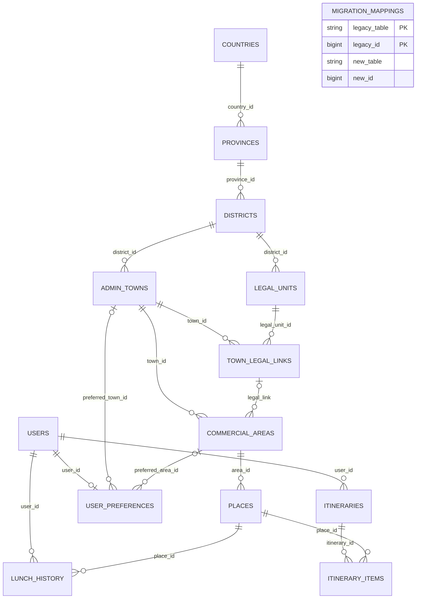

# V8.4 ERD 및 이관 관계

**V8.4 추가 테이블 `migration_mappings`** 은 실물 FK 대신 출처 테이블과 ID의 대응표를 저장합니다. 원본/신규 간 별도 DB를 강제로 묶는 FK는 만들지 않습니다.

## 데이터 연결 흐름

1. 사용자·관리자 둘 다 `GET /api/context/locations`, `GET /api/admin/locations/tree`를 통해 `lib/tree.js` 함수의 같은 구조를 조회
2. 화면의 가상 ID는 실제 ID와 테이블마다 다르게 인코딩, 국가/시도/시군구/읍면동/법정동/상권의 ID 충돌 방지
3. 장소 등록 시 가상 상권 ID를 검증하고 `commercial_areas.id`로 변환해 `places.area_id` FK 저장
4. 추천 조회 시 `places.area_id` 또는 `admin_towns.district_id` 조건으로 실제 장소 조회
5. 회원 선호는 `preferred_town_id`, `preferred_area_id`로 재연결; 방문/거부 기록은 `lunch_history.place_id` FK로 저장
6. 구버전에서는 `locations.level='ri'`의 일부가 법정동이므로 신규 `legal_units`·`town_legal_links`로 별도 연결. 상권은 항상 실제 `admin_towns`를 부모로 가짐

## 안전 정책

- 기존 DB `lunch_decision`: 백업과 이관 시 SELECT만 수행, UPDATE/DELETE/DDL 금지
- 신규 DB `lunch_decision_v83`: setup 단계에서만 DDL 실행, 이관 DML은 한 번의 트랜잭션
- 연결이 모호한 구버전 시/군/구 바로 아래 상권: 이관 보류, 다른 읍/면/동으로 자동 추정하지 않음
- `migration_mappings`는 같은 원본 ID의 중복 삽입을 방지하며 FK를 잃어버리지 않도록 검사
