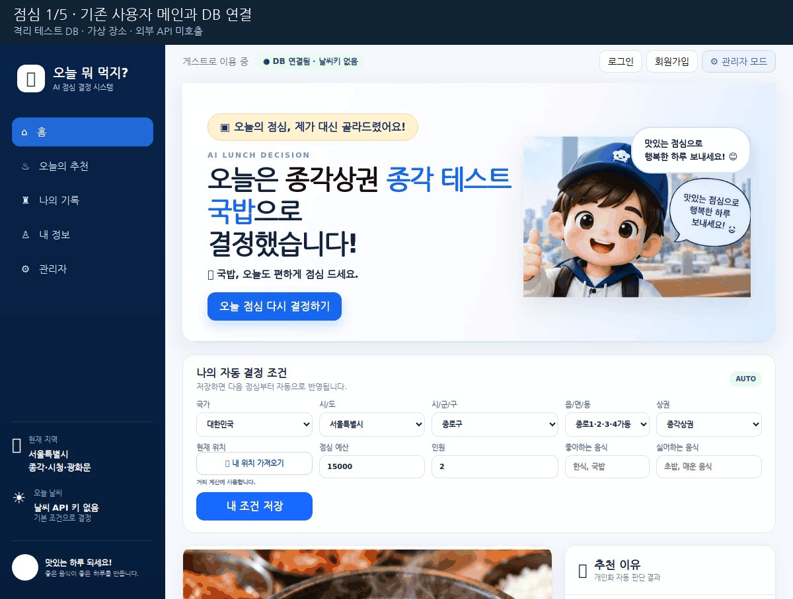
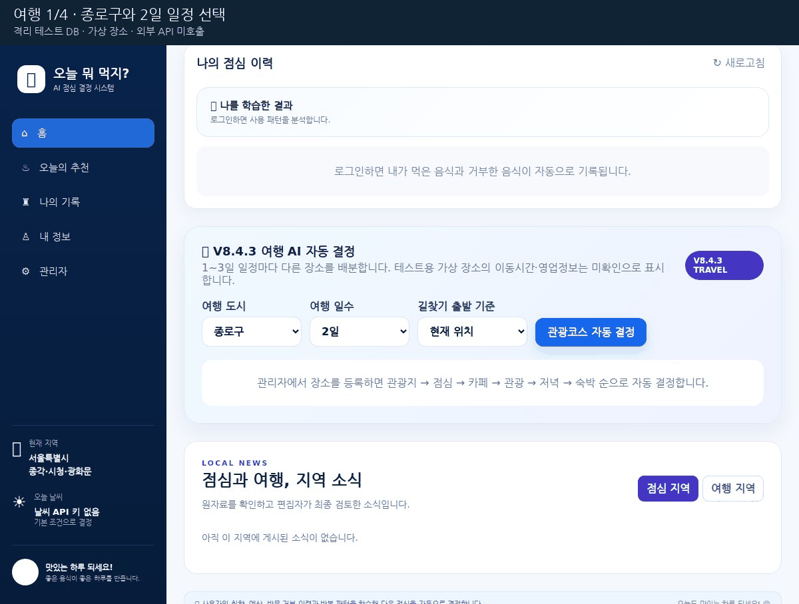
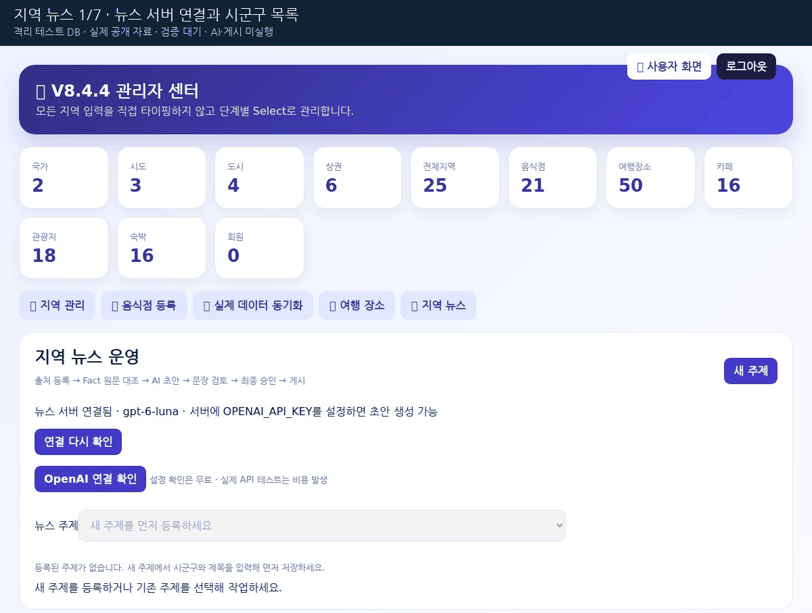
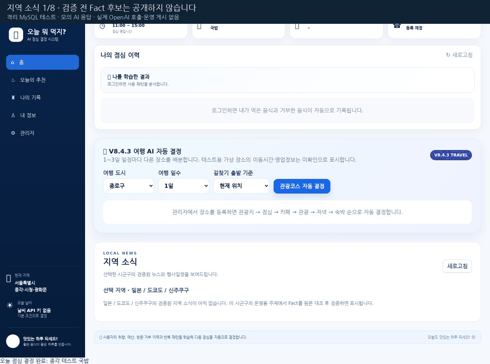
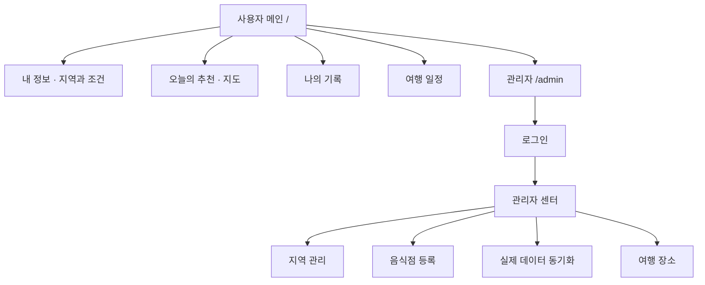
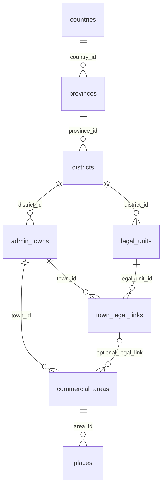
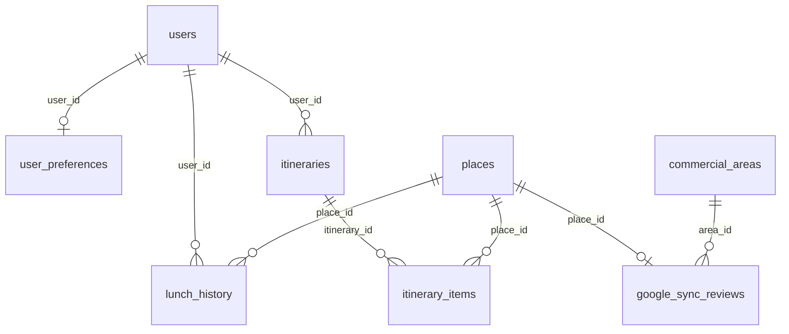

# 점심·여행 자동 결정 V8.4.4 + 뉴스 운영 V8.5.2

**시군구·뉴스 주제가 선택되지 않으면 [뉴스 연결 복구 안내](README_NEWS_RECOVERY.md)를 먼저 보세요.** 최신 18번 연결 복구 → 기존 서버 종료 → 09번 시작 → 관리자 화면 Ctrl+F5 → 연결 다시 확인 순서입니다.

한국·일본의 지역과 상권을 선택해 점심을 추천하고, 등록된 관광지·음식점·카페·숙박으로 여행 일정을 구성하는 Node.js·MySQL 웹 애플리케이션입니다. V8.4.4에는 관리자 확인을 거쳐 실제 Google Place ID를 연결하는 승인형 동기화 코드가 추가되어 있습니다.

**문서 기준:** 2026-10-20. 기존 V8.4.4 점심·여행 설계에 뉴스 제작·검토·게시 코드를 통합했습니다. 아래 1~5절은 기존 서비스 설계이며, 뉴스의 기능·화면·DB·수집·환경은 [뉴스 운영 V8.5.2 설계·실행 안내](README_NEWS_V8.5.2.md)에 추가했습니다.

**검증한 Fact가 메인에 안 보이거나 오른쪽에 점심 지역·여행 지역 버튼이 남아 있으면 [적용·확인 방법](docs/NEWS_PUBLICATION.md)을 보세요.** 이제 기사 생성 없이 Fact 검증 완료만으로 지역 소식에 표시합니다. 기존 기사 공개 이력이 있는 주제는 기사를 재검증·저장합니다.

**신규 뉴스:** Python FastAPI · MySQL · `gpt-6-luna`. 기존 뉴스 통합 브랜치의 출처·Fact·초안·문장별 근거 기능을 이식하고, 수정본 저장·사람의 원문 대조 확인·검증 저장·공개 중단·근거 변경 시 승인 해제를 구현했습니다. 기본 화면은 확인 체크 하나와 선택 메모로 검토·승인·공개를 함께 저장합니다. 관리자 `/admin`의 **지역 뉴스** 탭, 사용자 `/`의 **지역 소식**에서 사용합니다. 실제 OpenAI 호출에는 본인의 키와 모델 사용 권한이 필요합니다. [간편 검증 안내](docs/NEWS_SIMPLE_REVIEW.md)·[이번 변경 이력](CHANGELOG.md): 실제 MySQL 8.0.36 뉴스 테스트 98개, Node 테스트 36개, AI 없이 검증 Fact 표시·수정 후 제외·기사 교체·중단·관리자/사용자·일본·모바일 흐름 통과. [이전 구현 검증 기록](NEWS_TEST_REPORT.md). 실제 OpenAI 유료 호출은 미실행.

**처음 실행하려면 [Windows 상세 실행 순서](README_AUTOMATION.md)를 보세요.** 13번 키 설정 → 14번 실제 OpenAI 호출 시험 → 09번 웹 서버 → 15번 노션 DB 연결 → 16번 매일 한국 시간 16:00 예약 등록 → 17번 즉시 전체 실행 순서입니다. 새 예약은 검증 Fact로 미검토 초안을 만들고 노션 원자료·AI초안 DB에 저장합니다. 15번의 SQL 05 설치가 `news_automation_runs` 테이블 1개를 선택 추가하며, 검토·승인·게시는 사람이 진행합니다. [OpenAI 연결과 오류 안내](README_OPENAI.md).

- [지역 뉴스 — 현재 기능과 운영 흐름](#regional-news)
- [실행 화면 GIF](#demo)
- [1. 기능정의서](#1-기능정의서)
- [2. 화면구성도 및 화면 설계](#2-화면구성도-및-화면-설계)
- [3. DB 설계](#3-db-설계)
- [4. 데이터 수집 방법](#4-데이터-수집-방법)
- [5. 개발 환경](#5-개발-환경)
- [6. 코드 읽는 순서](#6-코드를-읽는-순서와-한국어-주석)
- [7. SQL 처리 방법](#7-sql-파일-처리-방법)
- [8. 테스트 체크리스트](#8-테스트-실행과-확인-항목)
- [9. 시스템 변경 시 문서·커밋 처리](#9-시스템-변경-시-문서커밋-처리)

버전별 상세 안내: [V8.4.2 여행·샘플](README_V8.4.2.md) · [V8.4.3 화면·길찾기](README_V8.4.3.md) · [V8.4.4 승인형 동기화](README_V8.4.4.md)

## 추가·변경 내용 (2026-10-20)

| 기존 문서 형식 | 변경 전 | 추가·변경 후 |
| --- | --- | --- |
| 1. 기능정의서 | 최종 게시 기사만 메인 조회 | 검증 Fact도 AI 없이 조회, 기사 저장 후 교체 |
| 2. 화면구성도/설계 | 이전 점심 지역·여행 지역 전환 | 지역 소식·새로고침, 검증 Fact/기사와 출처 표시 |
| 3. DB 설계 | 기존 뉴스 테이블·PK/FK | 구조 유지, verified·검증 기록·출처·공개 이력으로 조회; 추가 SQL 없음 |
| 4. 데이터 수집 방법 | 직접 등록·CSV/JSON → Fact 후보 | 수집 동일, 사람 검증 후 Fact 소식 열람; AI 기사는 선택 |
| 5. 개발 환경 | Node·FastAPI·MySQL | 구성 유지, 두 서버 재시작·Ctrl+F5와 화면 버전 확인 추가 |

[형식별 추가·변경 보고서](docs/NEWS_CHANGE_2026-10-20.md) · [제출 양식의 추가 기재](docs/ASSESSMENT.md#추가변경-기재-2026-10-20) · [검증 결과](NEWS_TEST_REPORT.md#news-fact-feed-verification) · [실행 화면](#demo).

<!-- REGIONAL_NEWS_START -->
<a id="regional-news"></a>

## 지역 뉴스 — 현재 기능과 운영 흐름

이 구역은 코드·SQL·자료 파일에서 자동 갱신합니다. [갱신 방법과 범위](docs/NEWS_README_AUTOMATION.md).

| 항목 | 현재 구현 |
| --- | --- |
| 뉴스 버전 · 모델 | V8.5.2 · `gpt-6-luna` (설정·사용 권한 필요) |
| 화면 | 관리자 `/admin` → **지역 뉴스** · 사용자 `/` → **지역 소식** |
| 실행 구조 | Node.js 화면·세션 → 내부 토큰 프록시 → Python FastAPI → MySQL |
| 예약 | Asia/Seoul 매일 **16:00** · 별도 예약 등록 필요 |
| DB | 기본 뉴스·버전 테이블 11개 + 선택 예약 테이블 1개 |
| 내부 API | 33개 경로·메서드 조합 · 관리자 요청은 `/api/news` 프록시 사용 |

| 순서 | 처리 | 다음 단계 조건 |
| --- | --- | --- |
| 1 | 등록된 시군구에서 뉴스 주제·출처 준비 | 원문 링크·필요 구절·이용 조건 또는 CSV/JSON 가져오기 |
| 2 | Fact 원문 대조 → Fact 검증 완료 | 기사 생성 없이 원문 검증 소식으로 메인에 표시; 후보·시연 자료 제외 |
| 3 | AI 기사가 필요하면 검증 Fact로 초안 생성 | 초안 본문은 비공개; 기존 검증 Fact 소식은 유지 |
| 4 | 원문과 기사 비교 → 확인 체크 하나 → 검증 완료·저장 | 메모는 선택; 승인·공개를 함께 저장하고 같은 주제의 Fact 카드를 기사로 교체 |
| 5 | 메인 지역 소식에서 읽기 | 점심·여행 지역과 무관하게 최신 30건; 공개 중단한 기사는 Fact로 재등장하지 않음 |

- **원문 비교·검증은 간단히:** 원문 근거와 기사를 나란히 읽고 확인 체크 1개 후 **검증 완료·저장**을 누릅니다. 메모는 비워도 되며 별도 최종 승인·게시 버튼이나 상태 변경 항목은 없습니다. [사용 순서·저장 오류 해결](docs/NEWS_SIMPLE_REVIEW.md).
- **메인에는 지역 소식만 표시합니다.** 점심·여행 지역 버튼이 없고 **원문 검증 소식(Fact)**과 **검증 기사**를 함께 읽습니다. Fact 검증·수정·기사 저장·공개 중단 알림, 화면 복귀, 새로고침, 보이는 화면의 30초 재조회로 갱신합니다. [이전 화면·미노출 확인과 적용 순서](docs/NEWS_PUBLICATION.md).
- **URL 자동 수집은 구현되어 있지 않습니다.** 원문 URL은 링크·근거로 저장하며 기사 본문을 자동 다운로드하지 않습니다.
- 16시 예약은 검증 Fact로 비공개 초안을 만들어 MySQL·노션에 저장합니다. 예약이 사람의 원문 확인을 대신하지 않습니다.
- Fact 내용·출처·근거가 바뀌면 해당 Fact는 검증 대기로 돌아가 공개 대상에서 제외되고 관련 기사는 중단됩니다. 기사로 공개한 이력이 있는 주제는 기사 재검증·저장으로만 다시 공개합니다. 시연 자료·불완전 출처·검증자 기록 없는 Fact·미검토 AI 초안은 공개하지 않습니다.

**출처 등록:** 자료 종류 → 발행 기관 → 자료 제목 → HTTPS 원문 URL → 공개 시점(UTC) → 관련 구절 → 이용 조건을 입력합니다. [종로 실제 입력 예시·UTC 변환·원문 확인 기록](docs/NEWS_SOURCES.md). 미리 정리한 파일은 **CSV·JSON 가져오기**로 입력하며 두 형식 중 하나만 사용합니다.

### 가져올 수 있는 지역 뉴스 자료

| 자료 파일 | Fact 후보 | 서로 다른 출처 |
| --- | --- | --- |
| [jongno_events_20261020.json](data/news/jongno_20261020/jongno_events_20261020.json) · [CSV](data/news/jongno_20261020/jongno_events_20261020.csv) | 8 | 3 |

자료를 가져오면 검증 대기 상태로 저장됩니다. 원문 일정·장소·이용 조건을 확인한 뒤 사용할 Fact를 검증합니다.

<details>
<summary>코드에서 읽은 뉴스 테이블·내부 API</summary>

기본 설치: `news_topics`, `news_sources`, `news_facts`, `news_fact_evidence`, `news_drafts`, `news_claims`, `news_claim_facts`, `news_reviews`, `news_publications`, `news_ai_usage`, `news_schema_version`.

선택 예약 설치: `news_automation_runs`.

`news_service/app.py`에 선언된 경로입니다. FastAPI 주소를 사용자 화면 주소로 사용하지 않습니다.

```text
GET /ai/status
POST /ai/check
GET /health
GET /regions
GET /topics
POST /topics
POST /topics/{topic_id}/import
GET /topics/{topic_id}/sources
POST /topics/{topic_id}/sources
PUT /topics/{topic_id}/sources/{source_id}
DELETE /topics/{topic_id}/sources/{source_id}
GET /topics/{topic_id}/facts
POST /topics/{topic_id}/facts
PUT /topics/{topic_id}/facts/{fact_id}
DELETE /topics/{topic_id}/facts/{fact_id}
POST /topics/{topic_id}/facts/{fact_id}/evidence
DELETE /topics/{topic_id}/facts/{fact_id}/evidence/{source_id}
POST /topics/{topic_id}/facts/{fact_id}/verify
POST /topics/{topic_id}/facts/{fact_id}/status
GET /topics/{topic_id}/fact-sheet
POST /topics/{topic_id}/generate
GET /topics/{topic_id}/drafts
GET /drafts/{draft_id}
POST /drafts/{draft_id}/revisions
POST /drafts/{draft_id}/claims/{claim_id}/review
POST /drafts/{draft_id}/review
POST /drafts/{draft_id}/publish
POST /drafts/{draft_id}/verify-and-save
POST /drafts/{draft_id}/unpublish
GET /public
GET /public/feed
GET /public/facts/{topic_id}
GET /public/{publication_id}
```

</details>

상세 안내: [기능·화면·DB·SQL·테스트](README_NEWS_V8.5.2.md) · [실행·16시 예약·노션](README_AUTOMATION.md) · [연결 복구](README_NEWS_RECOVERY.md) · [실제 OpenAI 연결](README_OPENAI.md).
<!-- REGIONAL_NEWS_END -->

<!-- DEMO_GIFS_START -->
<a id="demo"></a>

## 실행 화면 GIF

2026-10-20 Linux Chromium 134.0.6998.35 · Node.js/실제 FastAPI · MySQL 8.0.36-2ubuntu3의 **격리된 임시 테스트 DB**에서 녹화했습니다. 운영 PC의 실행 결과와 구분합니다. OpenAI·노션은 호출하지 않았습니다.

<details>
<summary>점심 추천 — 한국·일본 지역 선택과 결과</summary>

한국 종로구와 일본 신주쿠구를 실제 선택하고 추천 결과를 확인했습니다. 장소는 **가상 테스트 데이터**입니다.



</details>

<details>
<summary>여행 일정 — 2일 일정과 날짜별 여섯 단계</summary>

종로구 2일 일정의 **12개 단계**를 확인했습니다. 가상 장소의 이동시간·영업정보는 확인하지 않은 상태로 표시됩니다.



</details>

<details>
<summary>지역 뉴스 — 종로 CSV 가져오기와 출처 입력 항목</summary>

실제 공개 행사 CSV로 **출처 3건·Fact 후보 8건·근거 연결 8건**을 저장했습니다. 출처 편집 화면의 입력 항목도 확인했습니다. **AI 생성·Fact 검증 완료·승인·게시는 시연하지 않았습니다.**



</details>

<details>
<summary>지역 소식 — 검증 Fact 표시와 기사 검증·저장</summary>

격리 MySQL에서 **AI 생성 없이 검증 Fact가 메인에 표시**되고 원자료를 읽는 것을 확인했습니다. 이어 **모의 AI 응답**으로 확인 하나·빈 메모 기사 저장·카드 교체를 확인했습니다. 검증·수정 후 자동 갱신과 공개 중단도 시험했습니다. **실제 OpenAI 호출이나 운영 기사 게시가 아닙니다.**



</details>

[녹화 범위·다시 녹화하는 방법](docs/SCREEN_RECORDING.md). 이미지를 교체하면 녹화 기록도 함께 갱신합니다.
<!-- DEMO_GIFS_END -->

## 1. 기능정의서

### 1.1 사용자와 권한

| 구분 | 사용 범위 | 인증·저장 기준 |
| --- | --- | --- |
| 비회원 | 지역 선택, 점심 추천, 여행 생성, 지도·길찾기 | 회원 전용 이력·조건 저장은 로그인 필요 |
| 회원 | 비회원 기능 + 조건 저장·방문/거절 이력·집계 | `users` 계정, bcrypt 해시, Express 세션 |
| 관리자 | 지역·장소 등록, 연결 진단, 동기화 확인·활성화 | `.env`의 `ADMIN_USERNAME`·`ADMIN_PASSWORD`; 별도 관리자 테이블 없음 |

### 1.2 기능 목록

API 주소는 `/api`를 포함한 실제 경로입니다. 표의 “구현”은 소스 존재를 뜻하며 실제 사용자 환경의 통합 성공을 보증하지 않습니다.

| ID | 기능 | 입력·처리·결과 | 주요 API / 소스 | 상태 |
| --- | --- | --- | --- | --- |
| F01 | 한국·일본 지역 선택 | 국가→시도→시군구→읍면동→상권, 부모 변경 시 하위 선택 초기화 | `GET /api/context/locations`, [lib/tree.js](lib/tree.js) | 구현; 등록된 지역만 표시 |
| F02 | 회원가입·로그인 | 아이디·비밀번호·이름 검증, 가입 후 자동 로그인 | `POST /api/user/register`, `POST /api/user/login` | 구현 |
| F03 | 내 조건 저장 | 상권·예산·인원·선호/비선호 음식·좌표 저장 | `PUT /api/user/preferences` | 회원 전용 구현 |
| F04 | 오늘 점심 추천 | 활성 음식점을 조회해 점수순으로 1곳과 후보 최대 5곳 반환 | `POST /api/recommendation/today` | 규칙 기반 구현 |
| F05 | 방문·거절 기록 | 추천 장소에 방문 또는 거절, 거절 이유 저장 | `POST /api/recommendation/feedback` | 회원 전용 구현 |
| F06 | 이력·선호 집계 | 이력 최대 100건, 행동별·음식분류별·거절사유별 집계 | `GET /api/user/history`, `GET /api/user/learning` | 구현; ML 학습 모델 아님 |
| F07 | 날씨 조회 | 현재 위치 또는 지역 대표 좌표로 날씨 조회·표시 | `GET /api/context/today` | OpenWeather 키·연결 필요 |
| F08 | 지도·직접 길찾기 | 선택 장소/주소/좌표 또는 직접 입력한 목적지로 Google 지도 열기 | [public/map-links.js](public/map-links.js) | 구현; 지도 URL 자체는 관리자·API 키 불필요 |
| F09 | 여행 일정 생성 | 시군구·1~7일 입력, 하루 6단계 배분, 장소 부족 시 재사용 안내 | `POST /api/travel/auto-plan`, [lib/travel-plan.js](lib/travel-plan.js) | 구현; 네 종류 중 하나라도 없으면 HTTP 409 |
| F10 | 여행 장소 수 조회 | 음식점·카페·관광지·숙박 수량 조회 | `GET /api/travel/summary` | 구현 |
| F11 | 지역 등록·진단 | 국가부터 상권까지 등록, 부모/FK·비어 있는 상권 확인 | `POST /api/admin/locations`, `GET /api/admin/locations/diagnostics` | 관리자 전용 구현 |
| F12 | 음식점 등록 | 상권·명칭·분류·가격·주소·메뉴·평점·이미지 경로 등 저장 | `POST /api/admin/restaurants` | 관리자 전용 구현 |
| F13 | 관광지·카페·숙박 등록 | 상권·종류·명칭·가격·주소·선택 좌표 저장 | `POST /api/admin/places` | 관리자 전용 구현 |
| F14 | Google 검색 미리보기 | 상권·종류로 검색, 지역 일치 여부와 선택용 토큰 반환 | `POST /api/admin/sync-google-places/preview` | 연결부 보완 필요: 4.4절 |
| F15 | 동기화 비활성 저장 | 장소별 읍면동·상권 확인, 주소 재검증 후 승인 기록과 신규 장소 저장 | `POST /api/admin/sync-google-places/approve` | 구현 코드 있음; 실 DB/API 점검 필요 |
| F16 | 동기화 최종 활성화 | 승인 장소 조회 후 선택·재검증, `active=1` 전환 | `GET /api/admin/sync-google-places/pending`, `POST /api/admin/sync-google-places/activate` | 구현 코드 있음; 활성화 후 추천 대상 |
| F17 | 백업·이관·검증 | 기존/신규 DB 백업, 이관 미리보기·적용, FK 진단 | `backup`, `migrate:plan`, `migrate:apply`, `verify` | CLI 구현 |
| F18 | 상태 진단 | DB 연결·버전·외부 키 설정·동기화 테이블 준비 여부 확인 | `GET /api/system/check`, `GET /health` | 구현; 키 설정 여부와 실제 유효성은 다름 |

### 1.3 판단 규칙과 구현 한계

- 점심 점수는 DB 평점, 샘플 여부, 최소가격 대비 예산, 선호/비선호 음식, **최근 30일** 방문·거절 기록으로 계산합니다. 예산 초과는 감점 방식이며 절대 제외 조건은 아닙니다.
- 여행은 실제 등록 장소를 종류별로 나누고, 비샘플을 우선한 뒤 ID 순서로 날짜별 배분합니다. 오전 관광→점심→카페→오후 관광→저녁→숙박을 매일 구성하며 마지막 날도 숙박 단계가 포함됩니다.
- 날씨·인원·현재 위치를 화면에서 전달하더라도 현재 추천 점수와 여행 배분이 이를 모두 최적화에 사용하는 것은 아닙니다. 영업시간 자동 검증·예약·대중교통 환승 최적화·생성형 AI 여행 설계는 미구현입니다.
- 여행 저장 테이블은 있지만 현재 자동 생성 API는 일정을 응답으로 반환하며 해당 테이블에 저장하지 않습니다.
- 이미지 경로 입력은 제공하지만 사진 파일 업로드 API는 없습니다. 지역·장소의 전체 수정/삭제 CRUD도 제공하지 않습니다.
- 한국·일본 선택과 일본 지명 별칭은 있으나 화면은 한국어이며 추천 카드의 통화 기호는 현재 `₩`로 고정되어 있습니다. 일본어 UI·엔화 표시의 완전한 현지화는 후속 작업입니다.

## 2. 화면구성도 및 화면 설계

### 2.1 화면 구성

사용자 기능은 여러 독립 페이지가 아니라 **하나의 메인 페이지 안의 섹션과 팝업**으로 구성됩니다. 관리자는 별도 페이지의 탭으로 관리합니다.



### 2.2 사용자 화면 정의

| 화면 ID | 위치·컴포넌트 | 주요 입력·표시 | 동작·오류 처리 |
| --- | --- | --- | --- |
| U01 | `/` 상단·사이드 메뉴 | 게스트/회원 상태, DB 상태, 홈·추천·기록·내 정보·관리자 | 메뉴는 해당 섹션 이동; 관리자 버튼은 선택 팝업 |
| U02 | 메인 추천 히어로 | 상권·추천 음식점·대표메뉴·다시 결정 | 처리 중 버튼 비활성, 실패하면 재시도 버튼 |
| U03 | `#profile` 조건 카드 | 국가·시도·시군구·읍면동·상권, 위치, 예산, 인원, 음식 선호 | 상위 선택 변경 시 하위 초기화; 저장은 로그인 필요 |
| U04 | `#recommendation` | 음식 이미지·명칭·가격·추천 이유, 지도·길찾기, 방문/거절 | 출발지 현재 위치/지역 선택, 직접 목적지 입력, 피드백 기록 |
| U05 | 날씨·상세 정보 | 날씨·요일·거리·시간·메뉴·주소·전화 | 외부 조회 실패·좌표 누락은 미확인 안내 |
| U06 | `#history` | 이력 수·방문/거절/추천 기록·선호 집계 | 비회원은 로그인 안내 |
| U07 | `#travelAI` | DB의 여행 지역·1~7일·출발 기준, 날짜별 6단계·길찾기 | 일정 생성 후 일수 변경 시 재생성; 부족 장소 안내 |
| U08 | `#authModal` | 로그인/가입 전환, 이름·아이디·암호 | 성공 시 팝업 닫기·회원 상태 및 추천 갱신; 실패 메시지 표시 |

국가 선택 예시는 대한민국 또는 일본이며, 일본 샘플 경로는 **일본→도쿄도→신주쿠구→니시신주쿠→신주쿠상권**입니다. 여행 지역 목록은 실행 중 DB 조회 결과로 채워집니다. HTML의 초기 도시 목록만으로 전국·일본 전체 데이터가 준비되었다고 판단하지 않습니다.

### 2.3 관리자 화면 정의

| 화면 ID | 경로·탭 | 구성 | 처리 후 상태 |
| --- | --- | --- | --- |
| A01 | `/admin` 로그인 | 관리자 아이디·암호·오류 메시지 | 성공 시 관리자 센터와 통계 표시 |
| A02 | 지역 관리 | 국가→시도→시군구→읍면동→선택 법정동/리→상권, 새 지역 등록·연결 검사 | 현재 탭에서 목록·경로·검사 결과 갱신 |
| A03 | 음식점 등록 | 지역 선택, 이름·분류·가격·주소·메뉴·평점·이미지 경로·시간 | 현재 탭에 성공/실패 표시, 목록 갱신 |
| A04 | 실제 데이터 동기화 | 지역·장소 종류, 미리보기 표, 장소 선택·읍면동/상권 체크, 승인 목록 | 비활성 저장 후 승인 목록 갱신; 최종 활성화 별도 |
| A05 | 여행 장소 | 지역·관광/카페/숙박/음식점 종류·가격·주소 등 | 현재 탭에서 저장 결과·목록 갱신 |

**현재 동작:** 관리자 저장 후 무조건 사용자 메인으로 돌아가는 공통 처리는 없습니다. 각 관리자 탭에 남아 결과를 갱신하며, 상단 “사용자 화면” 버튼으로 `/`에 이동합니다.

화면 원본: [public/index.html](public/index.html) · [public/script.js](public/script.js) · [public/style.css](public/style.css) · [public/admin.html](public/admin.html)

## 3. DB 설계

### 3.1 DB 구성과 설계 원칙

- 현재 작업 DB: `lunch_decision_v83`, InnoDB·`utf8mb4`. V8.4.4로 프로그램을 올려도 DB 이름은 유지합니다.
- 기존 원본: `OLD_DB_NAME`, 기본 `lunch_decision`. 신규 DB와 이름이 같으면 연결 모듈에서 차단합니다.
- 기본 13개 테이블 + `migration_mappings` + `google_sync_reviews` = **기존 15개 테이블**입니다. 뉴스 설치 시 뉴스 10개 + 버전 관리 1개가 추가되어 총 **26개 테이블**이 됩니다. 조회용 뷰 `v_place_full_path` 1개입니다.
- 사용자·관리자 선택 목록의 가상 ID와 DB PK는 구분합니다. `lib/tree.js`에서 표시용 ID를 만들고 등록 API에서 실제 PK로 변환합니다.
- 관리자 인증은 환경변수, 세션과 동기화 미리보기 토큰은 서버 메모리를 사용합니다. `admins`·세션·미리보기 전용 DB 테이블은 없습니다.

### 3.2 테이블 정의와 PK/FK

`id`를 PK로 쓰는 일반 엔티티는 `BIGINT UNSIGNED AUTO_INCREMENT`입니다. 예외인 복합키·공유키는 표에 명시했습니다.

| 테이블 | 역할·핵심 컬럼 | PK | FK |
| --- | --- | --- | --- |
| `countries` | 국가: `code VARCHAR(8)`, `name VARCHAR(100)`, `currency CHAR(3)`, 활성 여부 | `id` | 없음 |
| `provinces` | 시도·도도부현: `code VARCHAR(48)`, `name VARCHAR(150)` | `id` | `country_id → countries.id` |
| `districts` | 시군구·일본 하위 지역, 코드·명칭·활성 여부 | `id` | `province_id → provinces.id` |
| `admin_towns` | 읍면동·일본 하위 지역, `kind ENUM(eup,myeon,dong,other)` | `id` | `district_id → districts.id` |
| `legal_units` | 법정동·리, `kind ENUM(legal_dong,ri,other)` | `id` | `district_id → districts.id` |
| `town_legal_links` | 행정동과 법정동/리의 다대다 연결 | `(town_id,legal_unit_id)` | `(district_id,town_id) → admin_towns(district_id,id)`, `(district_id,legal_unit_id) → legal_units(district_id,id)` |
| `commercial_areas` | 상권, `code`·`name`·`active`·`is_demo` | `id` | `town_id → admin_towns.id`, `(town_id,legal_unit_id) → town_legal_links`; 법정단위 선택 |
| `places` | 음식점·카페·관광지·숙박 통합, 가격·주소·좌표·Google ID | `id` | `area_id → commercial_areas.id` |
| `users` | 회원: `username VARCHAR(80)`, `password_hash VARCHAR(255)`, 표시 이름 | `id` | 없음 |
| `user_preferences` | 회원별 예산·인원·선호 음식·지역·현재 위치 | `user_id`, `BIGINT UNSIGNED` | `user_id → users.id`, `preferred_town_id → admin_towns.id`, `(preferred_town_id,preferred_area_id) → commercial_areas(town_id,id)` |
| `lunch_history` | 추천·방문·거절·수락, 방문일·거절사유·메모·점수 | `id` | `user_id → users.id`, `place_id → places.id` |
| `itineraries` | 여행 저장용 헤더: `start_date DATE`, `days TINYINT UNSIGNED` | `id` | `user_id → users.id` |
| `itinerary_items` | 여행 저장용 날짜·순서·예정시각·이동시간 | `id` | `itinerary_id → itineraries.id`, `place_id → places.id` |
| `migration_mappings` | 구버전 테이블·ID와 신규 테이블·ID 대응 | `(legacy_table,legacy_id)` | 물리 FK 없음; 원본/신규 별도 DB 대응표 |
| `google_sync_reviews` | 장소당 현재 승인 정보, 확인 관리자·읍면동/상권 확인·활성일 | `place_id`, `BIGINT UNSIGNED` | `place_id → places.id`, `area_id → commercial_areas.id` |

`google_sync_reviews`는 장소마다 한 행을 두고 재승인 때 갱신합니다. 승인 작업 전체를 누적 보관하는 감사 로그 테이블은 아닙니다.

### 3.3 주요 컬럼과 제약

| 대상 | 물리 정의·제약 |
| --- | --- |
| 장소 종류 | `places.place_type ENUM('restaurant','cafe','attraction','lodging')` |
| 장소 명칭·주소 | `name VARCHAR(180) NOT NULL`, `address VARCHAR(255) NULL` |
| 좌표·가격 | `latitude/longitude DECIMAL(10,7)`, `price_min/price_max INT UNSIGNED`; 최고가격≥최저가격 CHECK |
| 장소 중복 | `UNIQUE(area_id,name,place_type)`, `UNIQUE(google_place_id)` |
| V8.4 장소 확장 | `main_menu`·`description`·`phone`·`image_path`·`rating DECIMAL(3,1)`·`review_count`·`lunch_start/lunch_end TIME`·`open_days` |
| 회원·선호 | 아이디 UNIQUE; 회원별 선호 PK로 1:0..1; 선호 상권과 읍면동은 복합 FK로 연결 |
| 행동 이력 | `action ENUM('recommended','visited','rejected','accepted')`; `visit_date DATE`, `decision_score DECIMAL(8,2)` 등 |
| 여행 순서 | `UNIQUE(itinerary_id,day_no,sequence_no)`; 현재 생성 API의 저장 연동은 미구현 |
| Google 승인 | `reviewed_by VARCHAR(80)`, 주소 검증·읍면동/상권 확인 BOOLEAN, `approved_at/activated_at DATETIME` |
| 삭제 규칙 | 지역·장소 참조는 주로 RESTRICT; 회원 삭제의 조건·이력·여행, 여행 삭제의 항목은 CASCADE |

### 3.4 ERD

지역·장소 관계:



회원·이력·여행·승인 관계:



회원 선호의 선택 지역 FK와 복합 FK의 상세 정의는 위 표와 SQL을 기준으로 합니다. `migration_mappings`는 물리 FK가 없는 별도 대응표여서 ERD의 연결선에서 제외했습니다.

정의 원본: [기본 스키마](sql/01_schema.sql) · [V8.4 확장 참고 SQL](sql/02_v84_extensions.sql) · [V8.4.4 승인 테이블](sql/03_v844_google_sync.sql) · [설치 스크립트](scripts/setup.js) · [기존 상세 ERD](ERD-V8.3.md)

`sql/02_v84_extensions.sql`는 참고 정의입니다. 기존 컬럼을 확인하는 `npm run setup` 경로를 사용하며, 기존 운영 DB에 SQL 파일을 직접 재실행하지 않습니다.

## 4. 데이터 수집 방법

### 4.1 데이터별 출처·수집·저장

| 데이터 | 수집 경로 | 저장·이용 | 현재 범위 |
| --- | --- | --- | --- |
| 국가·행정구역·상권 | 관리자 수동 입력, 기존 DB 이관, 샘플 seed | 지역 테이블과 FK 관계 | 전국 법정동·일본 47개 도도부현 전체를 자동 수집하는 모듈은 없음 |
| 기존 회원·지역·장소·이력 | `migrate:plan`으로 대응 관계 확인 후 `migrate:apply` | 원본 읽기, 신규 DB 트랜잭션, ID 대응표 | 불명확한 연결은 보류·보고; 다른 지역에 추측 연결하지 않음 |
| 관리자 등록 장소 | 음식점/여행 장소 폼 | 입력한 명칭·주소·가격·선택 좌표 등 `places` | 자료 정확도는 등록자가 확인 |
| Google 장소 | Places API (New) Text Search + Place Details | Place ID·승인한 지역 FK·내부 식별 명칭·승인 정보 저장 | 미리보기 연결 보완 필요; 4.4절 |
| 날씨 | OpenWeather Current Weather | 요청 시 화면에 표시, 별도 날씨 테이블 없음 | 키 필요; 현재 위치 또는 코드에 정의된 대표 좌표 |
| 이동시간·거리 | OSRM Route API | 여행 응답의 분·km에 반영, 현재 일정 DB에 자동 저장하지 않음 | 실제 좌표가 확인된 비샘플 구간만 계산 |
| 추천·방문·거절 | 사용자 요청·행동 | 회원의 `lunch_history` | 비회원 행동을 DB에 영구 저장하는 기능 없음 |
| 시연 장소 | `seed:demo`, `seed:travel` | `is_demo=1`로 구분 | 가상 자료, 실제 영업·가격·주소·좌표 보증 없음 |

`seed:demo`는 [기본 6개 지역 경로](scripts/seed-demo.js)와 통합 시연 장소를 준비하고, [여행 샘플 스크립트](scripts/seed-travel-50.js)로 종로구에 **음식점·카페·숙박·관광지 각각 14곳, 합계 56곳을 추가**합니다. 56은 DB 전체 장소 수가 아닙니다. 스크립트 파일명의 `50`은 기존 명칭이며 실제 추가 대상은 56곳입니다.

### 4.2 승인형 Google Places 수집 흐름

아래는 API·DB 코드에 정의된 처리 흐름입니다. 미리보기 진입부의 알려진 문제는 4.4절과 함께 확인하세요.

| 단계 | 처리 | DB 상태·통제 |
| --- | --- | --- |
| 1. 지역 선택 | 활성 국가→시도→시군구→읍면동→상권 및 장소 종류 확인 | 실제 상권 PK로 경로 조회 |
| 2. 미리보기 | `POST /api/admin/sync-google-places/preview` | DB 저장 없음; 검색은 최대 12개 |
| 3. 주소 확인 | Google 국가 코드·시도·시군구 비교, 다른 등록 읍면동 감지 | 불일치·확인 불가는 승인 차단; 상권 지리 경계를 자동 확정하지 않음 |
| 4. 사람 확인 | 선택 장소마다 `confirmTown=true`, `confirmArea=true` | 두 확인이 모두 있어야 승인; 좌표로 지역 소속을 판단하지 않음 |
| 5. 비활성 저장 | `POST /api/admin/sync-google-places/approve`, Details 재검증 | 신규 `places.active=0` + `google_sync_reviews`; 오류 시 전체 저장 롤백 |
| 6. 승인 장소 조회 | `GET /api/admin/sync-google-places/pending?area_id=N` | 같은 상권의 승인 정보·활성 상태 조회 |
| 7. 최종 활성화 | `POST /api/admin/sync-google-places/activate`, 주소 다시 확인 | `confirmation="ACTIVATE"`와 장소 DB ID 필요; 트랜잭션으로 `active=1` |
| 8. 추천·여행 이용 | 활성 장소 조회, 필요 시 최신 이름·주소·좌표 조회 | 신규 미활성 장소는 제외; 최신 정보 조회 실패는 미확인 안내 |

미리보기 토큰은 같은 세션·상권에 묶이며 **10분** 후 만료됩니다. 서버 메모리에는 토큰·허용 Place ID·지역 경로 지문을 유지하고, 저장 후 토큰을 제거합니다. 서버 재시작 시 다시 미리보기를 해야 합니다.

Google Place ID가 다른 상권/장소 종류에 이미 연결되어 있으면 임의 이전·중복 저장을 차단합니다. 같은 상권·종류의 기존 장소는 재사용하며, **이미 활성 상태인 기존 장소를 재승인한다고 다시 비활성으로 바꾸지는 않습니다.**

### 4.3 API 명세·데이터 보관

| 서비스 | 현재 코드의 요청 | 응답 사용 |
| --- | --- | --- |
| Google Text Search (New) | `POST https://places.googleapis.com/v1/places:searchText`, `X-Goog-Api-Key`·`X-Goog-FieldMask`, `textQuery/pageSize/languageCode/regionCode` | `places.id/displayName/formattedAddress/addressComponents/types` |
| Google Place Details (New) | `GET https://places.googleapis.com/v1/places/{PLACE_ID}`, FieldMask 지정 | `id/displayName/formattedAddress/addressComponents/location` |
| OpenWeather | `GET https://api.openweathermap.org/data/2.5/weather`, `lat/lon/appid/units=metric/lang=kr` | 온도·날씨 설명·관측 시각 |
| OSRM | `GET https://router.project-osrm.org/route/v1/driving/{lon,lat;lon,lat}?overview=false` | 응답의 초→분, m→km 변환; 실패는 미확인 |

Google에서 가져오는 이름·주소·좌표는 승인형 수집 경로에서 장기 DB에 복제하지 않고 최신 조회 결과로 표시합니다. DB의 `places.name`에는 `Google 연동 장소 {ID 일부}`라는 내부 식별용 문자열을 사용합니다. 별도 관리자 수동 등록 필드와 이 수집 경로는 구분해야 합니다.

현재 Google 요청 FieldMask에는 가격·평점·리뷰 수·영업시간·사진이 없습니다. 해당 정보가 자동 수집·검증된 것으로 안내하지 않습니다. 이름·주소의 화면 표시와 별개로 장소 종류는 관리자 선택값으로 저장되므로 실제 업종도 사람이 확인해야 합니다.

Google 공식 정책은 Place ID 저장 예외와 표시·출처 표기 조건을 규정합니다. 현재 코드가 모든 표시 조건을 충족한다고 단정하지 않으며, 실제 공개 전 적용 화면별로 공식 정책을 확인합니다. 검색·Details 재조회에는 설정과 요청 필드에 따른 API 비용이 발생할 수 있습니다.

공식 자료 확인일: 2026-10-19.

- [Google Text Search (New)](https://developers.google.com/maps/documentation/places/web-service/text-search)
- [Google Place Details (New)](https://developers.google.com/maps/documentation/places/web-service/place-details)
- [Google Places 저장·표시 정책](https://developers.google.com/maps/documentation/places/web-service/policies)
- [Google Place ID 안내](https://developers.google.com/maps/documentation/places/web-service/place-id)
- [OpenWeather 현재 날씨](https://openweathermap.org/api/current)
- [OSRM API 문서](https://project-osrm.org/docs/v5.24.0/api/)

### 4.4 소스 검토에서 확인한 보완 사항

**동기화 미리보기의 인자 구조 불일치가 있습니다.**

[routes/api.js](routes/api.js)는 `sync.textSearch({path,siblings},type)`을 호출하지만, [lib/google-sync.js](lib/google-sync.js)의 `textSearch`는 인자의 최상위에서 `country_code`·지역 이름을 읽습니다. 이 때문에 지역 정보가 들어 있는 `path`를 제대로 읽지 못합니다.

일본·도쿄·신주쿠 샘플을 전달하고 네트워크 요청을 모의 처리해 확인한 요청 본문은 다음과 같습니다.

```json
{
  "textQuery": "     음식점",
  "pageSize": 12,
  "languageCode": "ko",
  "regionCode": "UNDEFINED"
}
```

이는 실제 Google 유료 호출 결과가 아니라 **현재 함수 연결로 만들어지는 요청의 재현 결과**입니다. 올바른 지역별 검색을 위해 전달 구조를 통일하고, 일본은 `JP/ja`, 한국은 `KR/ko` 및 선택 지역명이 생성되는지 확인해야 합니다. 기존 순수 테스트 통과만으로 이 진입부의 실 API 성공을 판단할 수 없습니다. 이번 변경은 README 작성이며 구현 코드는 수정하지 않았습니다.

## 5. 개발 환경

### 5.1 기술 구성

| 항목 | 현재 구성 |
| --- | --- |
| 개발·실행 기준 | Windows 11/10 + PowerShell; VS Code 등 편집기 사용 가능 |
| 서버 | Node.js, `package.json` 요구값 `>=18.18.0`; 실제 운영에는 지원 중인 LTS 사용 |
| 웹 프레임워크 | Express `^5.1.0` |
| DB | MySQL 8.x, InnoDB, `utf8mb4`, mysql2 `^3.14.4` |
| 화면 | HTML·CSS·브라우저 JavaScript; 별도 프런트엔드 빌드 단계 없음 |
| 환경설정·인증 | dotenv `^16.4.7`, bcryptjs `^2.4.3`, express-session `^1.18.2` |
| 외부 연결 | Node 내장 `fetch`, Google Places (New), OpenWeather, OSRM, Google 지도 URL |
| 기본 접속 | `http://127.0.0.1:3100/`, 관리자 `/admin`; `PORT` 변경 가능 |
| 기본 바인딩 | `127.0.0.1`에만 수신하므로 현재 설정 그대로는 다른 PC·휴대폰에서 접속 불가 |

의존성 값은 설치 결과가 아니라 [package.json](package.json)의 선언 범위입니다. 실제 고정 버전은 [package-lock.json](package-lock.json)을 따릅니다. 세션은 기본 메모리 저장소와 4시간 쿠키를 사용하며, 다중 서버용 세션 공유 구성은 없습니다.

### 5.2 폴더와 역할

| 경로 | 역할 |
| --- | --- |
| [server.js](server.js) | 정적 파일·API·관리자 경로·세션·오류 응답·서버 시작 |
| [routes/api.js](routes/api.js) | 회원·지역·장소·추천·여행·동기화 API |
| [db.js](db.js) | MySQL 풀, 원본/신규 DB 분리·이름 검증 |
| [lib/tree.js](lib/tree.js), [lib/travel-plan.js](lib/travel-plan.js) | 지역 선택 어댑터·여행 배분 |
| [lib/google-sync.js](lib/google-sync.js), [lib/route.js](lib/route.js) | Google 조회·주소 확인·임시 토큰, OSRM 조회 |
| `public/` | 사용자·관리자 HTML, 스크립트·스타일·이미지 |
| `sql/`, `scripts/` | 스키마·샘플·백업·이관·설치·진단 |
| `tests/` | Node 순수 로직·소스 연결 회귀 검사 |
| `backups/`, `diagnostics/` | 실행 시 생성하는 백업·검사 보고서 |

### 5.3 환경변수

[.env.example](.env.example)을 복사하되 기존 `.env`는 덮어쓰지 않습니다.

| 변수 | 기본/예시 | 용도 |
| --- | --- | --- |
| `PORT` | `3100` | HTTP 포트 |
| `DB_HOST / DB_PORT` | `127.0.0.1 / 3306` | MySQL 접속 |
| `DB_USER / DB_PASSWORD` | 본인 DB 계정·암호 | DB 인증 |
| `OLD_DB_NAME` | `lunch_decision` | 이전 DB 읽기·백업·이관 원본 |
| `V83_DB_NAME` | `lunch_decision_v83` | 현재 작업 DB |
| `SESSION_SECRET` | 충분히 긴 임의값 | 세션 서명 |
| `ADMIN_USERNAME / ADMIN_PASSWORD` | 본인 관리자 계정 | 관리자 인증; 예시 암호 변경 필수 |
| `OPENWEATHER_API_KEY` | 본인 키 또는 빈값 | 날씨 조회 |
| `GOOGLE_MAPS_API_KEY` | 본인 키 또는 빈값 | Places 검색·Details; 지도 URL 열기와는 별개 |

### 5.4 설치·업그레이드

GitHub에서 받은 경우 실제 실행 폴더는 저장소 안의 동명 폴더입니다.

```powershell
git clone https://github.com/choisunghwan1004-dev/lunch-decision-v8.4.4-approved-sync.git
cd lunch-decision-v8.4.4-approved-sync\lunch-decision-v8.4.4-approved-sync
npm ci
if (-not (Test-Path .env)) { Copy-Item .env.example .env }
notepad .env
```

**기존 V8.4.3 DB를 사용 중인 업그레이드:**

```powershell
npm run backup
npm run setup:sync
npm run test:ui
npm start
```

기존 데이터 이관이 끝났다면 `setup`·`migrate:apply`·샘플 등록을 다시 수행할 필요가 없습니다.

**DB가 없는 신규 시연 환경:**

```powershell
npm run setup
npm run setup:sync
npm run seed:demo
npm run verify
npm run verify:travel
npm start
```

`setup`은 현재 `V83_DB_NAME=lunch_decision_v83`만 자동 생성하도록 제한합니다. 기존 데이터가 있다면 먼저 백업·이관 계획을 확인하세요. `backup`은 `OLD_DB_NAME` 연결 실패 시 중단하므로, 원본 DB가 전혀 없는 신규 설치와 기존 데이터가 있는 업그레이드를 구분합니다.

### 5.5 검증과 확인 지점

| 명령·주소 | 확인 내용 |
| --- | --- |
| `npm run doctor` | 설정 포트·DB 연결 진단 |
| `npm run check` | 주요 서버 스크립트 문법 |
| `npm run test:ui` | 지역·지도·여행·동기화 순수 규칙/소스 검사 |
| `npm run test:map` / `npm run test:sync` | 지도·동기화 규칙 개별 검사 |
| `npm run verify` / `npm run verify:travel` | 실제 DB FK·지역·여행 샘플 연결 |
| `npm run test:api` | 실제 HTTP·DB 및 1/2/3일 일정; 필요 시 임시 서버 자동 시작 |
| `GET /api/system/check` | `version=V8.4.4`, `sync.schemaReady`, `sync.enabled` 등 |

이번 문서 작성 시 기존 `node --test tests/*.test.js`는 **29개 통과·실패 0개**였습니다. 실제 MySQL 연결, 유료 Google 호출, 실제 브라우저 클릭은 이번 검증에 포함하지 않았습니다. Google 미리보기의 모의 요청 검사는 4.4절에 따로 기록했습니다.

브라우저 확인: ① 한국/일본→지역→점심 추천·지도·여행 일수별 6단계 표시, ② 관리자의 지역/음식점 등록과 성공 메시지·목록 갱신을 확인합니다. 동기화 실연동은 4.4절의 연결 문제를 보완한 뒤 미리보기→비활성 저장→최종 활성화를 확인합니다.

---

평가 양식에 맞춘 기획·DB·수집·검수·실행 답안은 [제출 문서](docs/ASSESSMENT.md)에 정리했습니다. 처음 실행할 때는 [시작 안내](START_HERE.md)를 따라 무료 검사부터 확인하세요.

## 추가 실행 파일과 CSV JSON 수집

| 파일 | 사용 순서와 기능 |
| --- | --- |
| `08_뉴스_설치.bat` | 기존 V8.4.4 환경에서 뉴스 의존성·DB 준비. 기존 뉴스 구조는 백업 후 `--upgrade-existing` 옵션 사용 |
| `09_뉴스_서버시작.bat` | FastAPI 8001과 기존 Node 3100 실행 |
| `10_뉴스_무료테스트.bat` | 가상 환경·개발 의존성 준비 후 Node와 Python 무료 검사. MySQL·AI 키 불필요 |
| `11_뉴스_MySQL테스트.bat` | 별도 `news_test_*` DB에서 실제 DB·구형 SQL 이관 검사 |
| `12_뉴스_브라우저테스트.bat` | Chromium에서 실제 관리자·일본 지역·모바일·파일 가져오기 검사 |

서버 실행 후 `/admin` → 지역 뉴스 → **시연용 주제** 생성 → **CSV·JSON 가져오기**에서 `examples/news_demo.csv` 또는 `.json`을 선택하세요. 수업용 가상 Fact 3건과 출처·근거 연결이 저장되며, 원문 대조 전에는 모두 `candidate`입니다. 같은 파일을 다시 가져오면 Fact Key 중복으로 HTTP 409가 되고 일부 행만 저장되지 않습니다.

실제 수집 파일도 같은 열을 사용합니다. 필수 열은 `source_kind, organization, source_title, source_url, published_at, source_excerpt, license_note, fact_key, fact_type, value_text, excerpt_reference, evidence_note, is_demo`입니다. 수치·가격에는 `value_number`가 필요하고 `unit, event_start, event_end`는 선택 사항입니다. `is_demo`는 `true/false` 또는 `1/0`을 명시합니다. UTF-8 CSV 또는 객체 배열 JSON, 최대 40행·브라우저 파일 크기 180KB를 허용합니다. 예제의 `example.org` URL은 실제 수집 기사 출처가 아니며 운영 자료로 사용하지 않습니다.

API는 `POST /api/news/topics/{id}/import`에 `{ "format": "csv", "content": "파일 내용" }`를 받습니다. 관리자 세션과 기존 요청 확인 헤더가 필요합니다. 파일 전체를 검사한 뒤 한 트랜잭션으로 저장하고, 기존 URL의 내용이 다르면 덮어쓰지 않습니다. 이 기능을 위해 추가 SQL 테이블을 생성할 필요는 없습니다.

### 종로 실제 행사 자료 가져오기

2026-10-20에 공개 출처에서 확인한 **종로 행사 4건·Fact 후보 8건**을 추가했습니다. [CSV](data/news/jongno_20261020/jongno_events_20261020.csv) 또는 [JSON](data/news/jongno_20261020/jongno_events_20261020.json) 중 하나를 종로구의 운영 주제에서 가져오세요. 실제 예정 행사 자료이며 가상 샘플이 아닙니다. 새 주제 기준으로 출처 3건·Fact 8건이 검증 대기로 저장됩니다. 원문 직접 대조 후 검증·초안 생성·승인·게시를 진행합니다.

행사 목록·발행일·관련 기사·공식 교차 확인 링크·무료 파일 검사 명령은 [종로 수집 자료 안내](data/news/jongno_20261020/README.md)에 있습니다. CSV와 JSON은 같은 자료이므로 둘 다 가져오지 않습니다. 현재 시점의 수집본이며 새 웹 기사를 주기적으로 수집하는 기능을 추가한 것은 아닙니다. 이 자료를 넣기 위한 SQL 변경은 없습니다.

실행 결과는 `test-results/checks-offline.json`, `checks-mysql.json`, `checks-browser.json`과 같은 이름의 `.log`에 남습니다. 무료 검사는 실제 OpenAI를 호출하지 않습니다. Windows BAT는 Linux에서 직접 실행하지 않았으며, 내부 Python 실행기와 Node·MySQL·브라우저 명령을 검증했습니다.

## 6. 코드를 읽는 순서와 한국어 주석

바이브코딩으로 작성한 코드를 직접 확인할 수 있도록 서버·DB·화면·설치 스크립트와 SQL에 한국어 주석을 추가했습니다. 주석은 함수가 **무엇을 입력받아 어디에 저장하고 무엇을 반환하는지**, 검증·트랜잭션·승인 차단이 **왜 필요한지** 설명합니다. 기존 UI·State·선택자·실행 로직을 유지했습니다.

| 읽는 순서 | 파일 | 확인할 내용 |
| --- | --- | --- |
| 1 | [server.js](server.js) | 서버 시작, 세션, `/api/news`를 `/api`보다 먼저 연결하는 이유 |
| 2 | [db.js](db.js), [news_service/db.py](news_service/db.py) | 연결 풀, 기존/운영 DB 구분, commit·rollback |
| 3 | [public/index.html](public/index.html), [public/script.js](public/script.js) | 기존 점심·여행 화면, 지역 선택과 실제 PK 전달 |
| 4 | [routes/api.js](routes/api.js), `lib/` | 회원·지역·추천·여행 API와 판단 규칙 |
| 5 | [routes/news-proxy.js](routes/news-proxy.js), [news_service/app.py](news_service/app.py) | 브라우저 → Node 세션 인증 → FastAPI 요청 |
| 6 | [news_service/schemas.py](news_service/schemas.py), [validation.py](news_service/validation.py) | 필수값·수치·기간·출처·문장별 Fact 검사 |
| 7 | [news_service/service.py](news_service/service.py) | Fact Sheet → 초안 → 원문 비교 → 검증 완료·저장(검토·승인·공개 함께) |
| 8 | [news_service/article_ai.py](news_service/article_ai.py) | `gpt-6-luna` 요청·구조화 응답·사용량 기록 |
| 9 | [public/news-admin.js](public/news-admin.js), [public/news-public.js](public/news-public.js) | 입력 팝업·저장 후 목록 복귀·검증 Fact/기사 표시 |
| 10 | [news_service/setup.py](news_service/setup.py), `sql/` | 스키마 생성과 구형 뉴스 구조의 호환 처리 |

`PK`는 행을 식별하는 기본키, `FK`는 다른 테이블의 행을 참조하는 외래키입니다. `Fact Sheet`는 검증된 사실과 원자료 묶음이며, `hash`는 내용 변경을 감지하는 지문입니다. 해시 일치가 사실의 진위를 보증하지는 않습니다. 뉴스의 `generated`, `in_review`, `approved`, `published`는 각각 초안·검토 중·최종 승인·게시 상태입니다.

## 7. SQL 파일 처리 방법

### 7.1 파일별 용도와 적용 명령

`package.json`이 있는 프로젝트 폴더에서 실행합니다. SQL 파일을 전부 드래그해 일괄 실행하지 마세요. 먼저 `.env`의 DB 접속 정보와 `V83_DB_NAME=lunch_decision_v83`, `OLD_DB_NAME=lunch_decision`을 확인합니다. 두 DB 이름은 달라야 합니다.

| 순서 | SQL | 처리 방법 | 재실행 시 동작 |
| --- | --- | --- | --- |
| 1 | [01_schema.sql](sql/01_schema.sql) | `npm run setup` | 기본 테이블은 `IF NOT EXISTS`; 데이터 삭제 없음 |
| 2 | [02_v84_extensions.sql](sql/02_v84_extensions.sql) | 위 `npm run setup`이 필요한 확장 컬럼만 반영 | **파일 자체의 `ALTER ADD`를 반복 실행하면 중복 컬럼 오류 가능** |
| 3 | [03_v844_google_sync.sql](sql/03_v844_google_sync.sql) | `npm run setup:sync` | 승인 기록 테이블이 있으면 다시 만들지 않음 |
| 4 | [04_news_v852.sql](sql/04_news_v852.sql) | `.\.venv\Scripts\python.exe -m news_service.setup --init-env` | 신규 테이블·부족 컬럼/인덱스·버전 기록을 함께 확인 |
| 별도 | `tests/news/fixtures/*.sql` | 자동 이관 테스트 전용 | **운영 DB에 직접 실행하지 않음** |

`01_schema.sql`에는 기본 DB 생성과 `USE lunch_decision_v83`가 있습니다. `scripts/setup.js`도 이 DB 이름만 자동 생성을 허용합니다. 뉴스 설치는 루트 `.env`의 `DB_HOST/DB_PORT/DB_USER/DB_PASSWORD/V83_DB_NAME`을 사용하며, 예전 독립형의 `NEWS_DB_*` 설정 파일을 자동으로 읽지 않습니다.

### 7.2 처음 설치하는 경우

MySQL 8 서버가 실행 중이어야 합니다. PowerShell을 열고 프로젝트 폴더로 이동합니다. 기존 `.env`가 있으면 덮어쓰지 않습니다.

```powershell
npm ci
# .env가 없는 경우에만 다음 명령 실행 후 DB·관리자 비밀번호를 편집
# Copy-Item .env.example .env
notepad .env
npm run setup
npm run setup:sync
py -3 -m venv .venv
.\.venv\Scripts\python.exe -m pip install -r news_service/requirements.txt
.\.venv\Scripts\python.exe -m news_service.setup --init-env
```

샘플을 보고 싶은 개발 DB에서만 `npm run seed:demo`를 실행합니다. 한국·일본 테스트 지역과 가상 장소를 추가하며 실제 관광 정보 수집이 아닙니다. 이미 V8.4.4를 운영하고 있다면 전체 초기화·샘플 등록 없이 뉴스 설치만 진행하세요.

### 7.3 기존 뉴스 테이블을 업그레이드하는 경우

먼저 서버를 종료하고 백업합니다. 기존 독립형/통합형 뉴스 테이블이 발견되면 기본 설치 명령은 멈추며, 백업 확인 후 다음 명령으로 호환 컬럼·인덱스를 추가합니다.

```powershell
.\.venv\Scripts\python.exe -m news_service.setup --init-env --upgrade-existing
```

구형 Fact는 검증 대기로, 기존 승인·게시 기사는 재검토 상태로 바뀝니다. 기존 기사·출처·검증 의견을 지우지 않습니다. 중복 데이터나 알 수 없는 스키마는 자동 삭제하지 않고 중단합니다. MySQL DDL은 자동 커밋되므로 설치 도중 오류가 나면 메시지를 확인하고 재실행하며, 전체 작업이 롤백되었다고 가정하지 않습니다.

**백업 파일의 종류를 구분하세요.** 기존 `npm run backup`은 옛 DB와 운영 DB를 읽어 `backups/*.ndjson.gz`와 Manifest를 만듭니다. 옛 DB가 없거나 접근 권한이 없으면 이 명령은 실패할 수 있습니다. 이 파일은 SQL이 아니므로 MySQL의 `SOURCE`로 읽을 수 없습니다. 특히 뉴스의 이진 해시까지 SQL로 보관하려면 `mysqldump --hex-blob`을 사용합니다.

다음은 로컬 MySQL 8 설치 경로의 예입니다. 실제 설치 경로·포트·계정·DB 이름에 맞게 바꿉니다. `--password` 뒤에 실제 비밀번호를 적지 말고 요청 시 입력합니다.

```powershell
New-Item -ItemType Directory -Force backups | Out-Null
& "C:\Program Files\MySQL\MySQL Server 8.0\bin\mysqldump.exe" --host=127.0.0.1 --port=3306 --user=root --password --single-transaction --hex-blob --databases lunch_decision_v83 --result-file="$PWD\backups\before_news_upgrade.sql"
if ($LASTEXITCODE -ne 0) { throw '백업 실패: 업그레이드를 진행하지 마세요.' }
Get-Item .\backups\before_news_upgrade.sql
```

### 7.4 MySQL에서 설치 결과 확인

Workbench의 쿼리 탭 또는 MySQL CLI에서 다음 **조회문**을 실행합니다. CLI 프로그램이 PATH에 없으면 설치된 `mysql.exe`의 전체 경로로 실행하세요.

```sql
USE lunch_decision_v83;
SELECT DATABASE();
SHOW TABLES;
SHOW TABLES LIKE 'news_%';
SELECT name, version, applied_at FROM news_schema_version;
SHOW COLUMNS FROM news_drafts;
SHOW INDEX FROM news_sources;
SELECT COUNT(*) AS source_count FROM news_sources;
SELECT status, COUNT(*) AS count FROM news_drafts GROUP BY status;
```

뉴스 업무 테이블 10개와 `news_schema_version` 1개, 버전 `8.5.2`, `news_drafts.fact_snapshot_json` 컬럼을 확인합니다. 설치 직후 행 수 0은 정상입니다. 기본 13개 + 이관 매핑 1개 + Google 승인 1개 + 뉴스 11개를 모두 설치한 경우 총 26개 테이블입니다.

`Table doesn't exist`는 설치 순서/DB 선택을, `Duplicate column`은 02 SQL을 직접 재실행했는지, `Access denied`는 루트 `.env`의 계정·비밀번호·DB 권한을 확인하세요. 비밀번호를 화면 캡처나 GitHub에 올리지 마세요.

### 7.5 SQL 덤프와 기존 백업 복원

`before_news_upgrade.sql`은 DB 생성·`USE`를 포함할 수 있으므로 운영 DB에서 무심코 실행하지 않습니다. 복구가 필요하면 별도 MySQL 인스턴스 또는 복구용 DB에서 대상 이름을 검토하고 확인합니다. `SOURCE`는 `.sql` 파일을 MySQL 클라이언트 안에서 실행하는 명령이며 PowerShell 명령이 아닙니다. PowerShell의 `< schema.sql` 리디렉션을 안내 명령처럼 그대로 입력하지 마세요.

기존 압축 NDJSON/Manifest는 `scripts/restore-to-new-db.js`의 **별도 복구 경로**이며 새 `lunch_restore_*` DB만 허용합니다. 파일 확장자를 SQL로 바꾸면 복원되는 방식이 아닙니다. 백업 성공과 실제 복원 성공은 별도로 확인해야 합니다.

## 8. 테스트 실행과 확인 항목

### 8.1 무료 기본 테스트

프로젝트 폴더에서 실행합니다. Python은 기존 가상 환경을 사용하며, 없다면 7.2절에서 먼저 준비합니다.

```powershell
.\.venv\Scripts\python.exe -m pip install -r news_service/requirements-dev.txt
npm run check
npm run test:ui
.\.venv\Scripts\python.exe -m pytest tests/news -q
```

현재 기준 Node 31개, Python 기본 69개가 통과하며 MySQL 전용 5개는 기본 실행에서 건너뜁니다. 기본 Python 검사는 테스트 전용 SQLite 대역을 쓰지만 운영 DB는 MySQL입니다. AI 응답은 대역이므로 무료 테스트의 통과가 실제 OpenAI API 호출·모델 권한·청구 성공을 의미하지 않습니다.

### 8.2 DB와 서버가 필요한 테스트

| 명령 | 실행 조건 | 확인 항목 |
| --- | --- | --- |
| `npm run verify` | V8.4.4 DB 준비 | 스키마·FK·지역/장소 연결 |
| `npm run verify:travel` | 개발 DB에 여행 시연 자료 등록 | 3일·18단계 배분, 당일 중복, 장소 부족 |
| `npm run test:api` | 준비된 DB와 시연 지역·종류별 장소 | 상태 API, 권한 보호, 지역 트리, 점심·1~3일 여행 |
| `NEWS_TEST_MYSQL=1`로 Python 테스트 | 별도 임시 DB 생성·삭제 권한 | 실제 MySQL API 흐름과 구형 뉴스 SQL 2종 업그레이드 |
| `python tests/news/browser_smoke.py` | MySQL, Node, Playwright·Chromium | 관리자 등록·검수·게시와 일본·모바일 공개 화면 |

PowerShell에서 MySQL 통합 검사는 아래처럼 실행합니다. 테스트는 `news_test_*`라는 별도 DB를 만들고 해당 DB만 제거합니다.

```powershell
$env:NEWS_TEST_MYSQL='1'
.\.venv\Scripts\python.exe -m pytest tests/news -q
Remove-Item Env:NEWS_TEST_MYSQL
```

`test:map`, `test:sync`, `test:news-proxy`는 `test:ui`에 포함된 일부 테스트를 따로 실행하는 명령입니다. 같은 검사를 중복 집계하지 않습니다.

### 8.3 브라우저 수동 테스트 체크리스트

| ID | 실행할 동작 | 통과 기준 |
| --- | --- | --- |
| T01 | 사용자 화면에서 한국·일본 지역을 단계별 선택 | 부모 변경 시 하위가 초기화되고 실제 선택 지역의 장소가 표시됨 |
| T02 | 점심 다시 결정, 지도·직접 길찾기 | 기존 카드가 갱신되고 목적지 링크가 열림 |
| T03 | 개발 DB에서 1·2·3일 여행 선택 | 하루 6단계 표시, 미확인 구간을 실제 0분으로 표시하지 않음 |
| T04 | 비로그인 상태에서 비공개 뉴스 API 요청 | HTTP 401, 검증 Fact/기사 공개 조회만 접근 가능 |
| T05 | 관리자 뉴스 주제·출처·Fact 입력·수정 | 저장 후 팝업이 닫히고 목록 상태가 갱신됨 |
| T06 | 출처 없는 Fact 또는 직접 대조 미확인으로 검증 시도 | HTTP 422 등 입력 거절, verified로 바뀌지 않음 |
| T07 | 날짜 역전·수치 필수값 누락·잘못된 URL | 입력 오류가 표시되고 잘못된 자료를 저장/검증하지 않음 |
| T08 | 검증 Fact로 기사 초안 생성 | 기사 생성만으로 공개되지 않으며 원문 비교·검증 화면에 표시됨 |
| T09 | 원문 확인 없이 검증 저장 또는 불일치·오래된 근거 기사 저장 | 한글 안내 또는 409/422, 공개되지 않음 |
| T10 | 확인 체크 하나 후 검토 메모를 비운 채 검증 완료·저장 | 검토·승인·공개 함께 성공하고 메인 지역 소식에 표시됨 |
| T11 | 기사 수정 | 새 수정 번호 생성, 전 문장 재검토, 과거 원문·근거 보존 |
| T12 | 원문·기사 대조 → 확인 체크 → 검증 완료·저장 | 별도 승인·게시 조작 없이 지역 소식에 기사·출처 표시 |
| T13 | 게시 후 Fact·출처·근거 연결 변경 | 승인 해제, 게시 중단, 이전 원자료 스냅샷은 보존 |
| T14 | 시연 자료를 운영 승인·게시 시도 | 차단되며 공개 기사에 섞이지 않음 |
| T15 | 없는 ID·다른 주제 ID·오래된 내용 해시로 수정 | 404/409 등으로 거절, 다른 주제 데이터 손상 없음 |
| T16 | 모바일 너비에서 팝업·출처·카드·닫기 확인 | 텍스트 겹침·뉴스 영역 가로 넘침 없이 읽고 닫을 수 있음 |
| T17 | 새 종로구 주제에 실제 행사 CSV 또는 JSON 가져오기 | 출처 3건·Fact 8건이 검증 대기로 저장되고 재가져오기는 409로 거절됨 |
| T18 | `npm run docs:news` → `npm run test:docs` → `npm run docs:news:check` | 새 뉴스 자료·코드 정보 반영, 수동 영역 보존, 재실행 시 차이 없음, 없는 GIF 거절 |
| T19 | 메인을 먼저 열고 관리자에서 Fact 검증·수정·기사 저장·공개 중단 | 열린 메인 자동 반영·제거, 같은 주제 한 카드, 중단 후 Fact 재등장 없음 |
| T20 | 운영용 주제에서 Fact 검증 완료, AI 생성은 실행하지 않음 | 원문 검증 소식과 출처 표시, 후보·시연 자료 제외, AI 호출 0건 |
| T21 | 최신 파일 확인 후 실행 중인 화면 버전·캐시 확인 | 제목 지역 소식, 지역 전환 버튼 없음, `data-news-view="verified-facts-v1"`, HTML·뉴스 자산 no-store |

실제 OpenAI 테스트는 서버 `.env`의 키와 `gpt-6-luna` 사용 권한을 준비한 후 관리자에서 검증 Fact로 초안을 한 번 생성해 확인합니다. 비용이 발생할 수 있습니다. 실패 응답·미완료 응답을 승인 기사로 저장해서는 안 됩니다. Google 동기화의 알려진 진입부 문제는 4.4절을 확인하며, 무료 로직 테스트만으로 Google 유료 API 성공을 판단하지 않습니다.


## 9. 시스템 변경 시 문서·커밋 처리

이 프로젝트의 코딩 작업에서는 시스템 수정과 함께 **README·관련 상세 문서 갱신 → 변경 이력 기록 → 필요한 검증 → GitHub 커밋**을 진행합니다. 이미 요청한 변경 범위의 문서·테스트·커밋 처리는 매번 다시 확인하지 않고 함께 완료합니다. 작업 기준은 [AGENTS.md](AGENTS.md), 날짜별 기록은 [CHANGELOG.md](CHANGELOG.md)에 저장합니다.

| 변경 내용 | 함께 반영할 내용 |
| --- | --- |
| 기능·화면·API | 기능정의서, 화면 설명, 사용 방법, 관련 테스트 결과 |
| DB·SQL | DB 설계와 관계, 백업, SQL 실행 순서, 업그레이드·복구 방법 |
| 설정·개발 환경·실행 파일 | 환경변수 예제, 설치·시작·재시작 순서, 오류 해결 안내 |
| 검증·커밋 | 실제 실행 명령과 결과, 미실행 항목, 변경 목적, GitHub 커밋 링크 |

문서만 바뀌면 링크와 변경 내용 등 해당 범위의 검사를 수행합니다. 커밋에는 작업 파일만 포함하며 비밀정보와 기존 사용자 작업을 보호합니다. GitHub 권한 등으로 반영이 막히면 완료된 로컬 결과와 차단 사유를 안내합니다.

이 절차는 코딩 작업에 적용됩니다. 사용자 PC에서 임의로 수정한 파일을 감시해 자동 커밋하는 프로그램은 설치하지 않습니다.

**지역 뉴스 요약은 자동 갱신됩니다.** `npm run docs:news`가 코드·SQL·자료·실제 GIF 기록에서 위 자동 구역을 만들며 `npm run check`에도 연결되어 있습니다. `main`의 관련 파일이 바뀌면 GitHub Actions의 **Regional news README sync**가 검사 후 차이가 있는 README만 자동 커밋합니다. 기능 의미와 새 실행 화면은 사람이 확인·기록합니다. [갱신 범위·실행·권한 오류 안내](docs/NEWS_README_AUTOMATION.md).

<details>
<summary>통합 전 기록: 기존 설치·이관·뉴스 확장 작업 안내</summary>

아래는 **뉴스 V8.5.2 통합 이전의 기록**을 보존한 것입니다. 아래의 “뉴스 미포함·gpt-4.1-mini·최종 승인 미구현” 문구와 당시 검증 결과는 현재 상태가 아닙니다. 현재 구현·설치는 [뉴스 V8.5.2 안내](README_NEWS_V8.5.2.md)를 기준으로 확인하세요.

# 점심 선택 시스템 · 점심/여행 자동 결정 V8.4.4

한국·일본의 지역과 상권을 선택하고, 등록된 음식점·관광지·카페·숙박으로 점심과 여행 일정을 구성하는 Node.js / Express / MySQL 시스템입니다.

**문서 기준일: 2026-10-19**  
**이 저장소의 실행 버전: V8.4.4 — 관리자 확인·승인형 Google Places 동기화**  
**「점심 선택 시스템」의 최신 확장 작업: V8.5.1 AI 지역 뉴스 제작 센터**

이 README는 현재 저장소의 코드, 별도 브랜치의 뉴스 코드, 최신 대화에서 보고된 실행 결과를 구분합니다. 이번 커밋은 지정 폴더의 README만 갱신합니다.

## 1. 현재 코드와 최신 작업 상태

| 항목 | 상태와 근거 |
| --- | --- |
| 현재 저장소 `main` | V8.4.4 점심·여행·지도·Google 장소 승인형 동기화 코드 |
| Google 동기화 | 미리보기 → 개별 확인 → 비활성 저장 → 최종 활성화 API 구현. 아래에 검색 인수 구조 오류를 명시 |
| 현재 저장소의 AI 뉴스 | 뉴스 서비스·테이블 생성 스크립트·관리자 뉴스 메뉴가 아직 포함되지 않음 |
| 별도 V8.5.1 뉴스 작업 | 기존 V8.4.1 저장소의 두 기능 브랜치에 코드 존재. 이 저장소에 병합된 상태는 아님 |
| 뉴스 MySQL 실행 | 최신 대화 보고 기준, 사용자 PC에서 독립형의 `news_*` 10개 테이블 생성·조회와 기존 지역 4건 확인 |
| 실제 OpenAI 호출 | 최신 확인 기록에서 성공이 확인되지 않음. MySQL 점검만으로 OpenAI 성공을 판단하지 않음 |
| 뉴스 최종 승인·사용자 공개 | V8.5.2 후속 작업. V8.5.1 초안 생성 후 자동 게시하지 않음 |

뉴스용 테이블이 사용자 PC에 생성되어 있어도 이 저장소에 뉴스 화면/API가 자동으로 추가되지는 않습니다.

## 2. 현재 제공하는 기능

| 구분 | 기능 |
| --- | --- |
| 지역 | 국가 → 시·도 → 시·군·구 → 읍·면·동 → 상권, 법정동/리 연결 구조 |
| 사용자 | 회원가입·로그인, 개인 조건 저장, 점심 추천, 회원 방문/거부 피드백과 이력 |
| 점심 추천 | 예산·평점·선호/기피 음식·최근 회원 이력에 따른 규칙 기반 점수 |
| 관리자 | 지역·상권·음식점·카페·관광지·숙박 등록/조회, FK 연결 진단 |
| 여행 | 1~7일, 날짜별 관광 → 점심 → 카페 → 관광 → 저녁 → 숙박 |
| 장소 분산 | 종류별 순환 배분, 등록 장소가 충분하면 중복 회피 |
| 지도 | Google 지도 검색·길찾기, 장소명/주소 직접 입력, 출발 기준 선택 |
| 날씨 | OpenWeather 키 설정 시 현재 날씨 조회 |
| 이동시간 | 실제 장소의 좌표와 OSRM 자동차 경로 응답을 확인한 구간만 합산 |
| 시연 데이터 | 종로구 음식점·카페·관광지·숙박 각 14곳, 총 56곳 등록 스크립트 |
| 데이터 관리 | 원본 DB 백업, 별도 DB 이관, ID 대응표, 지역 연결 검사 |

56곳은 **가상 테스트 장소**입니다. 실제 매장·호텔로 안내하지 않으며, 지도는 해당 지역까지만 연결합니다. 실제 장소명·주소 또는 확인된 좌표를 등록해야 개별 장소의 경로를 안내할 수 있습니다.

현재 여행 엔진은 장소 분산과 연결 확인용입니다. 실제 영업시간·예약·날씨·예산·교통을 동시에 최적화하는 완성형 여행 예약 시스템으로 검증되지는 않았습니다.

## 3. V8.4.4 Google Places 승인형 동기화

관리자 화면의 **「🌐 실제 데이터 동기화」**에서 진행하도록 구성되어 있습니다.

1. 국가부터 읍·면·동과 상권까지 선택하고 장소 종류를 고릅니다.
2. 미리보기로 최대 12개 후보를 검색합니다. 이 단계에서는 DB에 장소를 저장하지 않습니다.
3. 서버가 주소의 국가·시도·시군구를 검사하고, 식별되는 다른 읍·면·동을 차단합니다.
4. 관리자가 장소별로 **읍·면·동 소속**과 **상권 소속** 두 항목을 확인합니다.
5. 승인한 신규 장소를 `places.active=0`으로 저장하고 승인 기록을 남깁니다.
6. 승인 장소 목록에서 최종 활성화를 요청하면 Google 주소를 다시 검증합니다.
7. `places.active=1`이 된 장소부터 점심·여행 추천 대상에 포함합니다.

같은 Google Place ID가 다른 상권이나 다른 장소 종류에 등록되어 있으면 자동 이전하지 않고 승인 트랜잭션을 중단합니다. 이미 활성 상태인 동일 장소를 재확인한 경우에는 기존 활성 상태를 유지합니다.

- **지역 확인:** 좌표로 상권 소속을 추정하지 않습니다. 상권 소속은 관리자 확인이 필요합니다.
- **미리보기:** 관리자 세션·선택 상권과 연결하며 최대 10분간 메모리에 유지합니다. 서버 재시작·만료·지역 연결 변경 시 다시 검색해야 합니다.
- **저장 범위:** 이 동기화 경로는 Place ID·상권 FK·종류·승인 기록과 식별용 이름을 저장합니다. Google에서 받은 이름·주소·좌표는 필요할 때 다시 조회하는 구조입니다.
- **공유 운영:** 여러 서버에서 운영하려면 세션과 미리보기 상태 공유 구성이 추가로 필요합니다.

상세 안내: [README_V8.4.4.md](README_V8.4.4.md)

### 코드 검토에서 확인한 검색 오류

현재 `routes/api.js`는 `sync.textSearch({path, siblings}, type)`을 호출하지만, `lib/google-sync.js`의 `textSearch`는 전달 객체에서 `country_code`·지역명을 직접 읽습니다.

그 결과 실제 네트워크를 사용하지 않는 모의 호출에서 다음 요청 값이 재현되었습니다.

```json
{
  "textQuery": "     음식점",
  "regionCode": "UNDEFINED"
}
```

**Google 미리보기 기능을 실사용하기 전에 이 인수 구조를 수정하고 실제 응답으로 검증해야 합니다.** 현재 순수 규칙 테스트만으로 검색 API 연결 성공을 보장할 수 없습니다. 이번 README 커밋에서는 프로그램 코드를 수정하지 않았습니다.

### 관리자 API

모든 경로에는 기존 관리자 세션이 필요합니다.

| 메서드·경로 | 역할 |
| --- | --- |
| `POST /api/admin/sync-google-places/preview` | `area_id`, `place_type`으로 후보와 미리보기 토큰 조회 |
| `POST /api/admin/sync-google-places/approve` | 토큰과 장소별 `confirmTown`·`confirmArea` 확인 후 비활성 저장 |
| `GET /api/admin/sync-google-places/pending?area_id=N` | 승인 장소와 활성 상태 조회 |
| `POST /api/admin/sync-google-places/activate` | 장소 ID 목록과 `confirmation: "ACTIVATE"`로 최종 활성화 |
| `POST /api/admin/sync-google-places` | 기존 단일 호출은 HTTP 409로 단계별 처리 안내 |

이전 README의 Google 수집 HTTP 501 비활성 안내는 V8.4.3까지의 설명입니다. V8.4.4에는 위 단계별 API가 추가되었으며, 현재 검색 오류와 실통합 검증 상태를 함께 확인해야 합니다.

## 4. Windows PowerShell 설치·실행

저장소 폴더와 실행 폴더 이름이 같습니다. `package.json`이 있는 **안쪽 폴더**에서 실행합니다.

```powershell
git clone https://github.com/choisunghwan1004-dev/lunch-decision-v8.4.4-approved-sync.git
cd lunch-decision-v8.4.4-approved-sync
cd lunch-decision-v8.4.4-approved-sync
npm install
```

현재 `package.json`에 명시된 Node.js 최소 버전은 18.18이며 DB는 MySQL 8.x를 기준으로 합니다.

### 처음 설치하는 경우

`.env`가 없을 때만 예제를 복사합니다.

```powershell
Copy-Item .env.example .env
notepad .env
```

```dotenv
PORT=3100
DB_HOST=localhost
DB_PORT=3306
DB_USER=root
DB_PASSWORD=YOUR_MYSQL_PASSWORD
OLD_DB_NAME=lunch_decision
V83_DB_NAME=lunch_decision_v83
SESSION_SECRET=replace-with-a-long-random-secret-at-least-32-characters
ADMIN_USERNAME=admin
ADMIN_PASSWORD=CHANGE_TO_YOUR_OWN_PASSWORD
OPENWEATHER_API_KEY=
GOOGLE_MAPS_API_KEY=
```

기존 데이터가 있으면 먼저 `npm run backup`의 성공과 백업 파일을 확인합니다. 신규 DB 준비가 필요한 경우에만 다음을 실행합니다.

```powershell
npm run setup
npm run seed:demo
npm run setup:sync
npm run verify
npm run verify:travel
npm start
```

- `setup`은 안전 장치상 `lunch_decision_v83`을 준비합니다. `OLD_DB_NAME`과 달라야 합니다.
- `setup:sync`는 신규 DB에 `google_sync_reviews` 승인 기록 테이블을 추가합니다.
- `seed:demo`는 56개 여행 샘플 등록도 포함합니다.
- Google 동기화를 사용하려면 서버용 키, Places API (New) 활성화·청구 설정을 확인하고 위 검색 오류를 먼저 해결합니다.

### 기존 V8.4.3에서 업데이트하는 경우

기존 서버를 `Ctrl+C`로 종료하고 새 폴더에 코드를 준비합니다. 기존 `.env`를 복사한 뒤 실행합니다.

```powershell
npm install
npm run backup
npm run setup:sync
npm run test:sync
npm run test:ui
npm start
```

이미 준비된 DB를 초기화하거나 `migrate:apply`·`seed:demo`를 반복할 필요는 없습니다.

### 접속과 상태 확인

- 사용자: http://127.0.0.1:3100/
- 관리자: http://127.0.0.1:3100/admin
- 서버/DB 상태: http://127.0.0.1:3100/health
- 연결 진단: http://127.0.0.1:3100/api/system/check

`PORT=3100` 기준이며 실제 설정에 맞춥니다. `sync.schemaReady`는 승인 테이블 존재 여부이고, `sync.enabled`는 테이블과 키 설정 여부입니다. **이 값이 true여도 실제 Google 요청 성공을 뜻하지 않습니다.**

V8.4.3의 지도 URL과 화면 구성은 유지됩니다. Google 지도 링크는 관리자 로그인이나 API 키 없이 사용할 수 있으며, OSRM 이동시간 계산과는 별도입니다. 이전 화면이 남으면 `Ctrl+Shift+R`로 새로고침합니다.

## 5. DB 구조·백업·이관·복원

주요 연결은 `countries → provinces → districts → admin_towns → commercial_areas → places`입니다. 법정구역은 `legal_units`·`town_legal_links`로 연결합니다.

| 테이블 | 역할 |
| --- | --- |
| `users`, `user_preferences` | 회원·개인 조건 |
| `lunch_history` | 추천·방문·거부 기록 |
| `migration_mappings` | 구 DB와 신규 DB의 ID 대응, 이관 중복 방지 |
| `google_sync_reviews` | 장소/상권 FK, 검토 관리자, 지역 확인, 승인·활성 시각 |

상세 관계: [ERD-V8.4.md](ERD-V8.4.md), [ERD-V8.3.md](ERD-V8.3.md)

기존 `lunch_decision`은 백업·이관에서 읽기 용도로 사용하며 신규 `lunch_decision_v83`에 쓰는 구조입니다. 부모 지역이 불명확한 항목은 보류하고 임의로 다른 읍·면·동에 연결하지 않습니다.

```powershell
npm run backup
npm run migrate:plan
```

`backups/latest-backup-manifest.json`, 압축 백업과 체크섬, `diagnostics/migration-plan-report.json`을 확인한 뒤 실제 이관이 필요한 경우 실행합니다.

```powershell
npm run migrate:apply
npm run verify
```

이관 오류는 신규 DB 트랜잭션을 롤백합니다. 보류 항목이 있으면 기본적으로 커밋을 거절합니다. 보류 내역을 검토해 일부만 이관하기로 결정한 경우에만 `node scripts/migrate.js --apply --allow-skips`를 사용합니다. 제외된 원본 행은 삭제하지 않으며 결과 보고서에 남깁니다.

아이디의 비밀번호 해시 또는 Google Place ID가 충돌하면 임의로 병합하지 않습니다. SQL 파일을 기존 DB에 직접 실행하지 않습니다.

백업을 별도 빈 DB로 복원하는 예:

```powershell
node scripts/restore-to-new-db.js lunch_restore_20261019 lunch_decision
```

복원 대상은 새로운 DB 이름을 사용합니다. 테이블·데이터 외 VIEW·트리거·프로시저는 별도로 확인합니다. 구버전 서버로 돌아가려면 새 서버를 종료하고 구버전 폴더에서 실행합니다. 신규 DB에 저장한 데이터는 구버전 DB로 자동 반영되지 않습니다.

## 6. 「점심 선택 시스템」 최신 확장 — V8.5.1 AI 지역 뉴스

최종 순서는 **지역·주제/출처 → Fact Sheet 입력·검증 → 검증된 사실만 초안 생성 → 관리자 검수 → 후속 최종 승인·사용자 게시**입니다.

- 종로구 등 기존 `districts.id`와 뉴스 주제를 연결합니다.
- 출처 URL·기관·발행일과 사실별 근거를 기록합니다.
- 관리자가 출처와 대조한 사실만 `verified`로 처리합니다.
- 검증된 Fact만 OpenAI Responses API의 `gpt-4.1-mini`에 전달합니다.
- 초안의 수치·지역/시각·인과·출처를 검수하고 수정·반려 기록을 보관합니다.
- 확인되지 않은 인터뷰·원인·통계를 만들지 않고 생성 직후 자동 게시하지 않습니다.
- 최종 승인과 사용자 공개는 V8.5.2에서 연결합니다.

### 현재 코드는 별도 저장소의 기능 브랜치에 있음

| 구분 | 코드 위치·실행 구조 |
| --- | --- |
| 독립형 | [feature/v8.5.1-ai-local-news](https://github.com/choisunghwan1004-dev/lunch-decision-v8.4.1-api-fixed/tree/feature/v8.5.1-ai-local-news/v84_integrated/news-service) — `news-service`, FastAPI 8000, 별도 개발용 관리자 인증 |
| 통합형 | [feature/v8.5.1-news-center](https://github.com/choisunghwan1004-dev/lunch-decision-v8.4.1-api-fixed/blob/feature/v8.5.1-news-center/v84_integrated/README_V8.5.1.md) — 기존 관리자 세션 → Node 내부 프록시 → FastAPI 8001 |

두 브랜치는 뉴스 DB 컬럼과 인증 구조가 다르므로 테이블 생성 SQL을 서로 호환된다고 가정해 함께 실행하지 않습니다. V8.4.4에 통합할 때는 적용할 구조를 정하고 기존 UI·기능·DB를 보존하는 변경분만 이관해야 합니다.

### 최신 실행 확인 범위

최신 대화 보고 기준으로 **독립형**에서 MySQL 뉴스 테이블 10개 생성·조회와 기존 지역 4건이 확인되었습니다.

`news_topics`, `news_sources`, `news_facts`, `news_fact_evidence`, `news_drafts`, `news_reviews`, `news_claims`, `news_claim_facts`, `news_publications`, `news_ai_usage`

`news_publications` 테이블이 존재해도 최종 승인·게시 기능이 완성되었다는 뜻은 아닙니다.

독립형 뉴스 폴더의 `live_check.py`는 기본 실행 시 MySQL만 확인합니다. 해당 브랜치의 `news-service` 폴더에서, 키와 환경을 준비한 뒤 다음을 실행하면 OpenAI 호출도 요청합니다. 실제 API 사용 비용이 발생할 수 있습니다.

```powershell
.\.venv\Scripts\python.exe live_check.py --openai
```

`diagnostics/news-live-check.json`의 `mysql.ok`, `openai.attempted`, `openai.ok`를 구분해 확인합니다. OpenAI 점검의 짧은 응답 성공과 실제 Fact Sheet 기반 기사 생성·저장은 별도 검증입니다.

**이 명령과 뉴스 폴더는 현재 V8.4.4 저장소에는 없습니다.** 뉴스용 환경변수도 별도 모듈 설정을 따라야 하며, 현재 Node 앱의 `.env`에 키만 추가해 뉴스 기능이 생기지는 않습니다.

### 다음 작업

- [ ] Google 미리보기 인수 구조 수정 및 실제 검색·승인·활성화 검증
- [ ] 적용할 뉴스 모듈을 V8.4.4 관리자 화면에 통합
- [ ] 실제 OpenAI 요청과 Fact Sheet → 초안 → DB 저장 통합 검증
- [ ] V8.5.2 관리자 최종 승인·사용자 공개 연결
- [ ] Notion 「AI사업계획서」 작업 기록에 구현·검증 결과와 ERD/흐름도 갱신

이번 README 변경은 뉴스 모듈 병합이나 Notion 수정을 수행하지 않습니다.

## 7. 검증 명령과 결과 해석

실행 폴더에서 사용합니다.

```powershell
npm run check
npm run test:ui
npm run doctor
npm run verify
npm run verify:travel
npm run test:api
```

| 명령 | 확인 범위 |
| --- | --- |
| `check` | 주요 JavaScript 문법 |
| `test:ui` | 지역·지도·여행·동기화 규칙의 Node 테스트 |
| `test:map` / `test:sync` | 지도 또는 동기화 테스트만 선택 실행 |
| `doctor` / `verify` | DB 접속·FK·지역 선택 연결 |
| `verify:travel` | 종류별 장소 수와 3일 일정 연결 |
| `test:api` | 실제 HTTP 화면/API와 여행 1·2·3일의 6·12·18단계 응답 |

`test:api`는 DB가 준비되어 있어야 하며, 서버가 없으면 임시 서버를 시작해 검사 후 자신이 시작한 서버만 종료합니다. 이 테스트는 실제 Google 유료 검색이나 OpenAI 기사를 검증하지 않습니다.

브라우저에서는 지역 연쇄 선택·회원 조건/이력·관리자 장소 등록·여행 일정·길찾기를 확인합니다. 검색 오류 수정 후 실제 상권으로 미리보기→비활성 저장→최종 활성화를 별도로 점검합니다.

진단 파일:

- `diagnostics/connection-report.json` — DB/FK/지역 선택 관계
- `diagnostics/screen-api-report.json` — HTTP 화면/API 검사
- `diagnostics/migration-plan-report.json` / `migration-apply-report.json` — 이관 검토/결과

**이번 문서 작업에서 확인한 것:** 저장소 코드·문서, 별도 뉴스 브랜치 코드, Google 검색 인수 불일치의 네트워크 없는 모의 재현.  
**이번 환경에서 실행하지 않은 것:** 실제 MySQL, 유료 Google API, OpenAI, 브라우저 통합 테스트. 사용자 PC의 최신 대화 보고와 이번 검증을 구분합니다.

## 8. 변경 관리와 참고 문서

기존 사용자·관리자 화면, 스타일, 상태와 세부 기능을 유지하며 필요한 코드·DB 변경 스크립트·문서만 커밋합니다. `.env`, API 키, DB 비밀번호, 실제 사용자 데이터와 백업은 올리지 않습니다.

기술 구성은 Node.js / Express 5 / express-session / bcryptjs / mysql2와 HTML·CSS·JavaScript입니다.

| 파일 | 역할 |
| --- | --- |
| [server.js](server.js), [routes/api.js](routes/api.js) | 서버·세션·지역·회원·추천·여행·동기화 API |
| [public/index.html](public/index.html), [public/admin.html](public/admin.html) | 사용자·관리자 화면 |
| [lib/google-sync.js](lib/google-sync.js) | Google 검색·지역 확인·미리보기 상태 |
| [lib/travel-plan.js](lib/travel-plan.js), [public/map-links.js](public/map-links.js) | 일정 구성·지도 링크 |
| [sql/03_v844_google_sync.sql](sql/03_v844_google_sync.sql) | 승인 기록 테이블 |
| [README_V8.4.4.md](README_V8.4.4.md) | 승인형 동기화 상세 안내 |
| [README_V8.4.3.md](README_V8.4.3.md), [README_V8.4.2.md](README_V8.4.2.md) | 지도·여행 개선 이력 |

기존 버전 문서의 과거 테스트 기록은 이번 환경의 실행 결과로 간주하지 않습니다.

</details>

