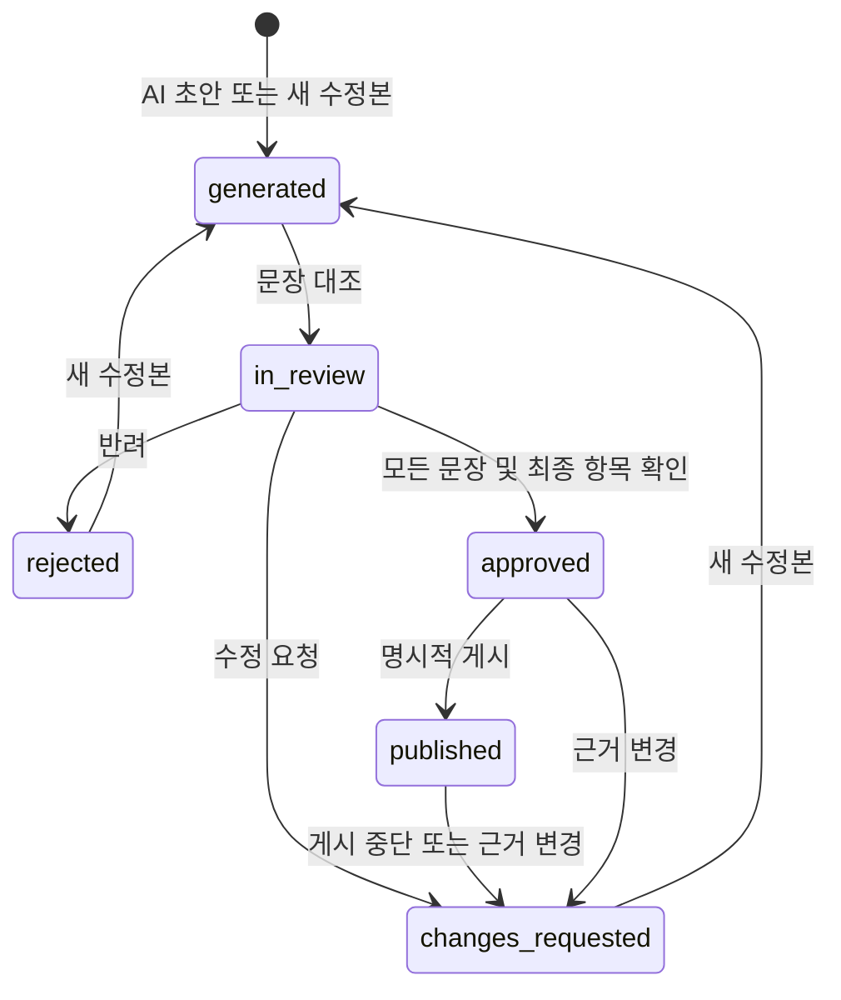
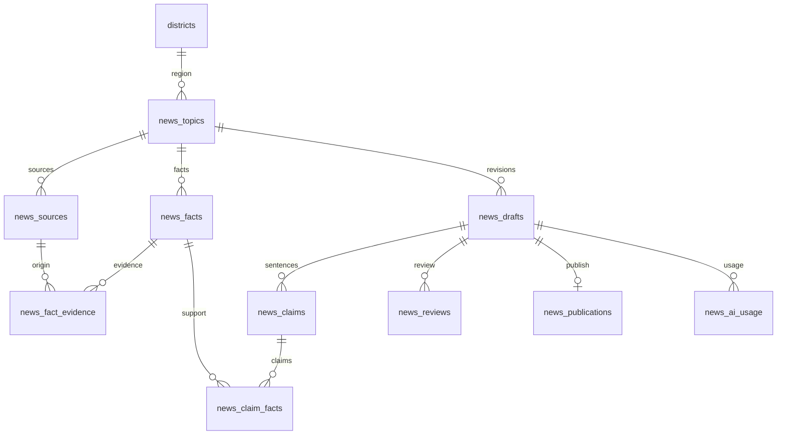

# V8.4.4 + 뉴스 제작·검토·게시 V8.5.2

실제 OpenAI 호출·매일 한국 시간 16시 예약·노션 저장을 시작하려면 [Windows 상세 실행 안내](README_AUTOMATION.md)를 보세요. 신규 실행 파일은 13~17번이며 예약은 별도 SQL 05의 실행 이력으로 같은 날짜·주제 중복을 막습니다.

기존 한국·일본 점심 추천과 여행 화면에 지역 뉴스를 추가합니다. 뉴스 백엔드는 **Python FastAPI + MySQL**, 초안 생성 모델은 **OpenAI `gpt-6-luna`**입니다. AI가 사실 여부를 판정하거나 자동 게시하지 않습니다. 관리자가 원자료를 직접 대조해 Fact를 검증하고, 제목·본문 문장마다 근거를 확인한 뒤 최종 승인과 게시를 따로 수행합니다.

현재 구현의 [자동 갱신 요약·자료 목록](README.md#regional-news), [실제 실행 화면](README.md#demo), [출처 입력 항목·UTC 변환 예시](docs/NEWS_SOURCES.md)를 함께 확인하세요. 관련 코드가 `main`에서 변경되면 [README 자동 갱신](docs/NEWS_README_AUTOMATION.md)이 해당 요약을 반영합니다. 상세 기능 정의와 새 동작 설명은 변경 작업에서 함께 수정합니다.

원본: [feature/v8.5.1-news-center](https://github.com/choisunghwan1004-dev/lunch-decision-v8.4.1-api-fixed/tree/feature/v8.5.1-news-center/v84_integrated), 기준 커밋 `d21fc0a3a8b39898b0cc41c04b31406a100e2ca4`. 원본의 출처·Fact 검증 함수, 10개 뉴스 테이블과 내부 프록시 흐름을 V8.4.4에 이식·보강했습니다. 원본의 `gpt-4.1-mini` 기본값은 사용하지 않습니다.

## 1. 기능정의서

| 단계 | 관리자 기능 | 저장·검증 조건 |
| --- | --- | --- |
| 주제 선정 | 기존 시군구, 축제·관광·교통·문화·기타 선택 | `districts.id` 연결; 한국·일본 공통 |
| 출처 등록 | HTTPS 원문 URL, 기관, 제목, 공개 시점, 관련 구절, 이용 조건 등록·수정 | 동일 주제 URL 중복 방지; 서버 자동 크롤링 없음; CSV·JSON 파일 일괄 수집 지원 |
| Fact Sheet | 사실 항목·수치·단위·기간 등록, 원문 위치와 근거 구절 연결 | 원문 직접 대조 체크·검증 의견이 있어야 `verified` |
| AI 초안 | 검증 Fact만 `gpt-6-luna`에 전달 | Responses API, JSON Schema, `store=false`, 자동 재시도 없음 |
| 문장 검토 | 제목(순번 0)과 각 본문 문장의 Fact·원자료 대조 | AI 결과는 모두 `unverified`; 사람이 일치·불일치 판정 |
| 기사 수정 | 제목·문장·Fact 연결 수정, 문장 추가·삭제 | 원문 덮어쓰기 대신 새 수정본; 모든 문장 재검토 |
| 최종 승인 | 수치, 시점·지역, 인과·과장, 출처·이용 조건 4항목 + 의견 | 모든 문장 `supported`, 현재 Fact·기사 해시 일치 필요 |
| 게시·중단 | 승인본 명시적 게시, 사유를 남겨 게시 중단 | 한 주제의 게시본은 하나; 교체 시 이전 게시본 중단 |
| 사용자 열람 | 점심 지역 또는 여행 지역의 기사·출처 조회 | 승인·게시된 운영 자료만 공개; 초안·시연 자료 제외 |
| 추적 | 수정본·검토자·검토 의견·시각·모델·토큰 사용량 기록 | 기사와 근거 스냅샷을 승인에 함께 묶어 저장 |

출처 수정, Fact 수정·삭제·재검증·상태 변경, 근거 연결 변경 시 해당 주제의 문장 검토·승인을 해제하고 게시를 중단합니다. 수정된 Fact는 원문 대조부터 다시 진행해야 합니다. 단순 기사 편집은 새 버전을 만들고 기존 승인 게시본은 새 버전이 승인·게시될 때까지 유지합니다.

수치·날짜가 정확히 인용되어도 맥락·진위가 보장되지는 않으므로 **Fact 검증과 최종 편집 검토는 사람의 별도 작업**입니다. 현재 관리자는 기존 `.env` 관리자 계정을 공유합니다. 검토 이력은 기록하지만 작성자와 승인자의 계정 분리나 2인 승인 정책은 구현하지 않았습니다.

## 2. 화면구성도·설계

- `/admin` → 기존 관리자 로그인 → **지역 뉴스** 탭. 주제 선택 아래 출처, Fact Sheet, 초안 목록을 표시합니다.
- 등록·수정은 대화상자에서 진행하고 저장 후 뉴스 목록으로 돌아옵니다.
- 기사 검토 대화상자는 왼쪽에 제목·문장·검토, 오른쪽에 검증된 Fact·원자료 구절·원문 링크를 표시합니다. 모바일에서는 세로로 배치합니다.
- 사용자 `/` → 여행 영역 아래 **점심과 여행, 지역 소식**. 점심 지역/여행 지역을 전환하고 기사를 열면 본문과 원자료 출처를 확인합니다.
- 메인은 전체 지역·새로고침을 제공하며 같은 브라우저의 게시·중단 알림과 화면 복귀 때 목록을 다시 조회합니다. 관리자에는 출처·Fact·검증·기사·승인·게시 저장 수와 다음 작업을 표시합니다. 최종 승인 후 기사 창에서 별도 **승인본 게시**를 진행합니다. [메인 미노출 점검 순서](docs/NEWS_PUBLICATION.md).
- 기존 점심·여행·지도·지역·음식점·Google 승인형 동기화 화면을 유지합니다. 기존 Google 장소 활성화는 뉴스 Fact 검증·게시 승인과 별개입니다.



## 3. DB 설계

기존 15개 테이블에 뉴스 10개 테이블과 버전 관리 1개를 추가합니다. 기존 점심·여행 테이블의 데이터와 컬럼을 변경하지 않습니다. `OLD_DB_NAME`에는 연결하지 않으며 `V83_DB_NAME`이 같으면 실행을 중단합니다.

| 테이블 | 주요 내용 |
| --- | --- |
| `news_topics` | 시군구 FK, 주제, 분류, 운영/시연 구분 |
| `news_sources` | 출처 URL 해시, 발행 기관, 공개 시점, 관련 구절, 이용 조건, 내용 해시 |
| `news_facts` | Fact Key, 유형, 값·수치·단위·기간, 사람의 검증 상태·의견·시각 |
| `news_fact_evidence` | Fact ↔ 출처, 원문 위치, 대조 메모 |
| `news_drafts` | 부모 수정본, 주제 내 수정 번호, 제목·본문, 모델, Fact 해시·원자료 JSON 스냅샷, 승인자 |
| `news_claims` | 제목 0번·본문 1번 이후 문장, 검토 결과·메모·시각 |
| `news_claim_facts` | 문장 ↔ Fact 연결 |
| `news_reviews` | 요청·수정·반려·승인·게시·중단 이력, 기사·Fact 해시 |
| `news_publications` | 공개 ID·slug, 게시 버전·시각, 중단 사유 |
| `news_ai_usage` | 요청 ID, 모델, 입력·출력·캐시 토큰, 성공·실패 코드; 비용은 미계산 NULL |
| `news_schema_version` | 뉴스 스키마 적용 버전 |



Fact 스냅샷은 주제·지역, 검증 Fact 값뿐 아니라 출처 URL·기관·공개 시점·관련 구절·이용 조건·대조 메모까지 포함합니다. 기사 해시는 제목·본문·문장별 Fact 연결을 포함합니다. 수정본마다 당시 Fact·출처·관련 구절의 JSON 스냅샷도 보존하여 근거 변경 후에도 과거 자료를 확인할 수 있습니다. 승인 시 두 해시를 저장하고 게시 및 공개 조회 시 다시 검사합니다. 게시·수정 작업은 주제 행 잠금으로 직렬화합니다. AI 대기 중에는 잠금을 잡지 않고, 응답 후 근거가 바뀌면 사용량만 기록하고 초안을 폐기합니다.

### 기존 뉴스 테이블이 있는 경우

`python -m news_service.setup`은 신규 설치 시 `sql/04_news_v852.sql`을 적용합니다. 기존 독립형 `news-service` 또는 통합형 `news-center`의 10개 테이블은 최소 구조와 InnoDB 엔진을 확인한 뒤 `--upgrade-existing`으로 필요한 컬럼·인덱스를 추가합니다. 기존 행은 삭제하지 않습니다.

- **먼저 `npm run backup`을 실행하세요.** MySQL DDL은 자동 커밋되므로 실패 시 전체 롤백되지 않습니다. 설치가 끝나기 전에 버전은 완료로 기록하지 않으며, 지원 구조는 재실행할 수 있습니다.
- 기존 Fact는 검증 대기로, 기존 승인·게시 데이터는 새로운 해시 기준으로 재검토하도록 해제합니다. 구형 검증 의견·검토 이력과 기사 원문은 보존합니다.
- 독립형에 운영/시연 구분이 없었다면 기존 주제·초안·출처는 시연 자료로 보수적으로 분류합니다. 운영용 새 주제를 만들고 원자료를 다시 등록하세요.
- 기존 `check_passed` 필드, 구형 ENUM 상태, 수정 번호가 없는 초안을 호환 처리합니다. 중복 URL·Fact Key·문장 순번·게시 버전이나 알 수 없는 스키마는 삭제 없이 중단합니다.
- 기존 테이블에 자동 수집 데이터를 덮어쓰거나 구형 SQL 두 종류를 번갈아 적용하지 마세요. 백업 복원은 기존 `scripts/restore-to-new-db.js` 방식으로 새 DB에서 확인합니다.

## 4. 데이터 수집·Fact 검증 방법

1. 지자체·관광청·교통 기관 등 원발행처의 공개 자료를 확인합니다. 일본 지역도 기존 지역 DB에서 선택하고 한국어 Fact·기사를 작성할 수 있습니다.
2. URL, 기관, 자료 제목, 공개 시점(입력 기준 UTC), 필요한 구절과 이용 조건을 직접 기록합니다. 뉴스 API는 URL을 방문하거나 본문을 수집하지 않습니다. 기존 Google Places 동기화의 장소 정보는 뉴스 근거로 자동 승격하지 않습니다.
3. 날짜·장소·가격·운행 변경 등 사실을 Fact 단위로 분리하고 근거 자료의 쪽·문단·대조 구절을 연결합니다.
4. 원문을 직접 열어 대조한 뒤 체크와 검증 의견을 저장합니다. `candidate`, `rejected`, `disputed`, `outdated` Fact는 AI 입력에서 제외합니다.
5. 검증 Fact로 초안을 생성하고 **제목까지** 문장별로 원문과 대조합니다. 생성 결과에 없는 근거를 붙여 진위를 자동 승인하지 않습니다.
6. 수정본 재검토 → 최종 4항목 확인 → 승인 → 게시 순서로 진행합니다. 정정이 필요하면 게시 중단 사유를 남기고 Fact와 기사를 수정합니다.

원자료 구절과 검증 메모도 초안 생성 입력에 포함됩니다. OpenAI에 전송할 권한이 있는 자료만 등록하세요. 한 주제의 생성 입력은 검증 Fact 최대 40개·60,000자이며, 요청 출력 한도는 1,800토큰입니다. API 비용은 계정 사용량에서 확인합니다.

SQL 파일별 처리·백업·오류 확인은 [README 7절](README.md#7-sql-파일-처리-방법), 실행 명령과 수동 검증 항목은 [README 8절](README.md#8-테스트-실행과-확인-항목)을 함께 확인하세요.

## 5. 개발 환경·실행

- Python **3.11 이상 권장** (검증 환경 3.12), MySQL **8.0**, 기존 Node.js **18.18 이상**. Express 로그인·점심·여행 서버는 3100, 뉴스 FastAPI는 로컬 8001입니다.
- Python 의존성은 `news_service/requirements.txt`에 버전을 고정했습니다. OpenAI SDK 2.54.0의 Responses API·Structured Outputs를 사용합니다.
- `OPENAI_NEWS_MODEL=gpt-6-luna`가 아니면 AI 생성을 중단합니다. 계정에서 해당 모델의 사용 권한이 있어야 합니다.
- [OpenAI 모델 문서](https://developers.openai.com/api/docs/models/gpt-6-luna) · [Structured Outputs](https://developers.openai.com/api/docs/guides/structured-outputs)

프로젝트의 `package.json`이 있는 폴더에서 실행합니다. 기존 V8.4.4가 설치되어 있다면 데이터 초기화·샘플 등록을 반복할 필요가 없습니다.

### Windows PowerShell

```powershell
npm ci
# 신규 V8.4.4 설치인 경우에만 기존 .env DB 설정 후 npm run setup 실행
py -3 -m venv .venv
.\.venv\Scripts\python.exe -m pip install -r news_service/requirements.txt
npm run backup
.\.venv\Scripts\python.exe -m news_service.setup --init-env
# 기존 news_* 테이블이 있다는 안내가 나오면, 백업 확인 후 다음 실행
# .\.venv\Scripts\python.exe -m news_service.setup --init-env --upgrade-existing
```

`.env`의 기존 DB·관리자·세션 설정을 유지하고 다음을 채웁니다. `--init-env`는 비어 있거나 잘못된 내부 토큰을 자동 생성하며 토큰 값을 출력하지 않습니다. 기존 OpenAI 모델 설정은 자동 덮어쓰지 않으므로 구형 모델이면 직접 수정하세요.

```dotenv
NEWS_SERVICE_URL=http://127.0.0.1:8001
NEWS_INTERNAL_TOKEN=설치_명령이_생성한_64자리_16진수
OPENAI_NEWS_MODEL=gpt-6-luna
OPENAI_API_KEY=본인의_OpenAI_API_키
```

터미널 A:

```powershell
.\.venv\Scripts\python.exe -m uvicorn news_service.app:app --host 127.0.0.1 --port 8001
```

터미널 B:

```powershell
npm start
```

브라우저에서 `http://127.0.0.1:3100/admin` → 지역 뉴스. 사용자 화면은 `http://127.0.0.1:3100/`입니다. `.env` 변경 후 두 서버를 재시작하세요. 배치 파일 `08_뉴스_설치.bat`(설치)·`09_뉴스_서버시작.bat`(두 서버 실행)도 제공합니다.

macOS/Linux에서는 `python3 -m venv .venv`, `.venv/bin/python`을 사용하면 됩니다. 가상 환경 활성화 후에는 `npm run news:setup`, `npm run news:run`, `npm run news:test` 단축 명령을 사용할 수 있습니다.

### 인증과 API

브라우저는 `/api/news/*`를 사용하고 기존 Express 관리자 세션으로 접근합니다. 수정 요청에는 같은 출처 확인과 `X-News-Request: 1`이 필요합니다. 프록시가 고정 로컬 FastAPI 주소로 내부 토큰과 서버가 결정한 검토자를 전달합니다. 브라우저에 OpenAI 키나 내부 토큰을 전달하지 않습니다. FastAPI는 공개 기사 조회를 포함해 모든 경로에서 내부 토큰을 요구하며, 문서/OpenAPI 경로는 노출하지 않습니다.

| 경로 (Node의 `/api/news` 뒤) | 역할 |
| --- | --- |
| `GET /health`, `/regions`, `/topics` | 운영 상태·지역·주제 조회 |
| `POST /topics` | 주제 등록 |
| `GET/POST /topics/{id}/sources`, `PUT/DELETE .../sources/{sid}` | 출처 관리 |
| `GET/POST /topics/{id}/facts`, `PUT/DELETE .../facts/{fid}` | Fact 관리 |
| `POST .../facts/{fid}/evidence`, `DELETE .../evidence/{sid}` | 근거 연결·해제 |
| `POST .../facts/{fid}/verify`, `.../status` | 사람의 검증·상태 변경 |
| `GET /topics/{id}/fact-sheet`, `/drafts` | 검증 자료·수정본 목록 |
| `POST /topics/{id}/generate` | 유료 AI 초안 생성 |
| `GET /drafts/{id}`, `POST .../revisions` | 기사·근거·검토 이력, 새 수정본 |
| `POST /drafts/{id}/claims/{cid}/review` | 문장 대조 기록 |
| `POST /drafts/{id}/review`, `/publish`, `/unpublish` | 최종 검토·승인·게시·중단 |
| `GET /public?district_id=1&limit=6`, `/public/{id}` | 로그인 없이 게시 기사·출처만 조회 |

기존 Node 세션은 메모리 저장소와 로컬 HTTP 실행을 유지합니다. 여러 서버 인스턴스·외부 배포 시 HTTPS와 영속 세션 저장소 설정이 별도로 필요합니다. MySQL 비밀번호·키·`.env`를 Git에 올리지 마세요.

## 검증

```powershell
.\.venv\Scripts\python.exe -m pip install -r news_service/requirements-dev.txt
.\.venv\Scripts\python.exe -m pytest tests/news -q
npm run test:ui
npm run check
```

기본 Python 테스트는 **테스트 전용 SQLite 어댑터**로 API·트랜잭션 흐름을 검증합니다. 운영 코드의 DB는 MySQL만 사용합니다. 실제 MySQL 검증은 다음처럼 실행하면 테스트마다 `news_test_*`라는 별도 임시 DB를 만들고 해당 DB만 삭제합니다. 테스트 계정에 DB 생성·삭제 권한이 필요하며 기존 `V83_DB_NAME`을 지우지 않습니다.

```powershell
$env:NEWS_TEST_MYSQL='1'
.\.venv\Scripts\python.exe -m pytest tests/news -q
Remove-Item Env:NEWS_TEST_MYSQL
```

AI 호출은 기본 테스트에서 대역으로 처리하여 실제 비용이 발생하지 않습니다. 실제 OpenAI 호출과 운영 환경의 최종 확인은 본인의 키를 설정하고 관리자에서 검증된 Fact로 초안을 한 번 생성해 확인하세요. 자동으로 기사를 게시하거나 시연 자료를 운영 DB에 등록하는 테스트 명령은 없습니다.

선택 사항: MySQL이 실행 중인 개발 환경에서 브라우저까지 검증하려면 `pip install playwright`, `python -m playwright install chromium`, `python tests/news/browser_smoke.py`를 실행합니다. 별도 `news_test_ui_*` DB에서 Node·FastAPI를 띄우고 종료 후 테스트 DB만 제거합니다. AI는 이 전용 테스트 앱에서만 대역으로 교체하며, 운영 DB 이름이면 테스트 앱 시작을 거부합니다.

이번 구현의 검증 결과는 [검증 기록](NEWS_TEST_REPORT.md)에 정리했습니다.

## CSV JSON 가져오기와 일괄 테스트

추가된 파일 가져오기·무료/DB/브라우저 실행 파일은 [README 실행 안내](README.md#추가-실행-파일과-csv-json-수집)를 따릅니다. 가져온 자료는 검증 대기로만 저장합니다. 시연 파일은 시연용 주제에서만 사용할 수 있으며 운영 게시할 수 없습니다.
