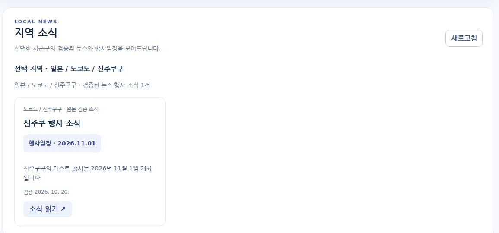
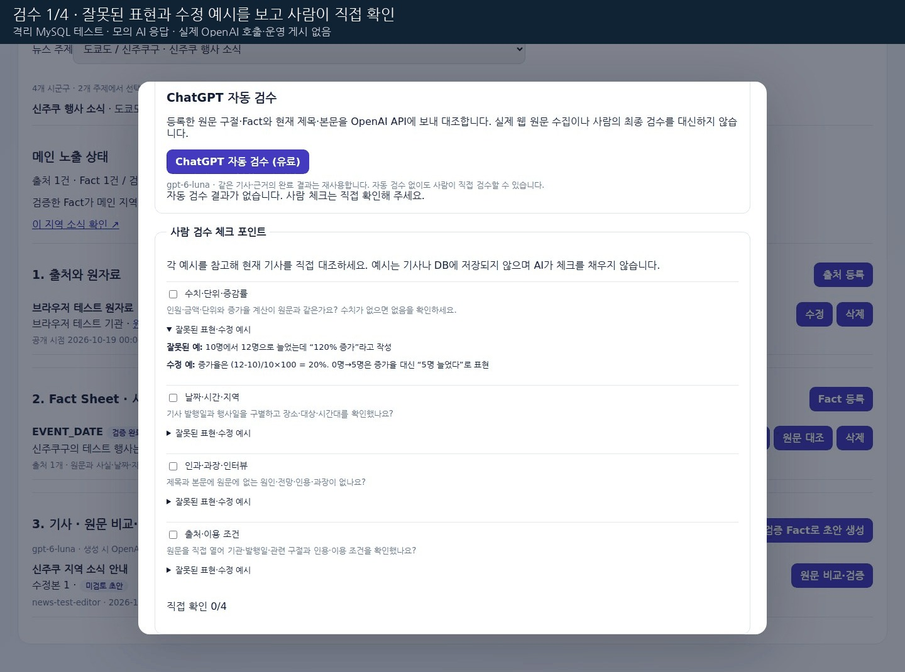

# 도메인에 맞는 뉴스 세팅하기 추가 자료

2026-10-20 작성. 한국·일본의 지역관광·생활·문화 소식을 다루는 기존 뉴스 세팅 양식에 **메인 화면·관리자 화면의 처리, 행사일정, 기타 변경 내역**을 반영했다. 기존 평가 문항·공통 오류 검수 연습·SQL 조회 증거와 미실행 항목은 보존했다.

- [최신 Word 제출본](2차_도메인에_맞는_뉴스_세팅하기_최성환.docx)
- [위치별 기능·화면·DB·수집·환경 설계](NEWS_LOCATION_2026-10-20.md)
- [Windows 적용과 화면 진단](NEWS_PUBLICATION.md)

## 1 기능정의서 반영

| 항목 | 추가·변경한 처리 |
| --- | --- |
| 지역 소식 | 메인 상단에서 선택한 시군구의 검증된 소식·기사 최신 30건 |
| 행사일정 | 검증 날짜 Fact의 `date`·`date_range`, 시작일·종료일. 기사에는 실제 제목·본문 근거로 연결된 행사만 표시 |
| 관리자 | 원문 대조·Fact 검증, 선택적 ChatGPT 참고 검수·예시와 사람 네 포인트·기사 검증 완료 저장, 수정본·공개 중단 |
| 간편 흐름 | 성공 시 팝업을 닫고 목록·열린 메인 갱신. 입력 오류는 팝업에 사유 표시 |
| 적용 확인 | 19번 진단으로 파일·실제 제공 HTML/JS·Python 버전 8개 검사 |

ChatGPT 검수·사람 체크의 상세 설계·샘플은 [AI 검수 보완](NEWS_AI_REVIEW.md)과 기타부에 추가했다. Word의 기능정의서 F05를 보완하고 F11 시군구별 소식, F12 행사일정, F13 적용 버전 진단을 추가했다. 상태 변경 버튼은 제공하지 않는다.

## 2 메인 화면 처리와 설계

| 순서 | 사용자 조작·화면 | 서버·화면 처리 |
| --- | --- | --- |
| 1 | 상단 국가 → 시/도 → 시군구 선택 | 화면의 가상 옵션 ID를 실제 `districts.id`로 변환 |
| 2 | 지역 소식 자동 갱신 | `main-region-changed` → `/api/news/public/feed?district_id=선택값&limit=30` |
| 3 | 뉴스·행사 카드 확인 | 검증 Fact 소식 또는 검증 저장 기사, 지역·제목·행사일정·요약·검증/게시 날짜 |
| 4 | 소식 읽기 | 같은 시군구로 상세를 재검사하고 내용·행사일정·원자료 출처 표시 |
| 5 | 지역 변경·선택 해제 | 이전 카드·상세창을 비우고 이전 요청의 늦은 응답 무시 |
| 6 | 자료가 없거나 API 실패 | 검증 자료 없음과 연결 오류를 구별해 안내 |

여행 도시 선택과 GPS 거리 계산은 기존 기능을 유지한다. 뉴스 위치는 **메인에서 선택한 시군구**이며 GPS를 자동으로 주소 변환하지 않는다. 관리자 변경 알림·화면 복귀·새로고침·보이는 탭의 30초 재조회를 유지한다.

실제 격리 MySQL·브라우저 테스트 화면이다. 내용은 테스트용 행사이며 운영 뉴스가 아니다. 아래 관리자 화면의 기사도 모의 AI 응답이다.

## 3 관리자 화면 처리와 설계

| 순서 | 관리자 조작 | 저장·검사·복귀 |
| --- | --- | --- |
| 1 | 기존 로그인 → 지역 뉴스 → 시군구·주제 선택 | 해당 주제 출처·Fact·기사 목록과 저장 수 표시 |
| 2 | 출처 등록 또는 CSV·JSON 가져오기 | URL·발행일·구절·이용 조건, Fact 후보와 근거 연결 저장. 가져오기 충돌은 전체 취소 |
| 3 | Fact 근거 연결 → 원문 대조 → Fact 검증 완료 | 사람이 원문을 확인. 후보·시연·불완전 출처 제외. 성공 시 팝업 닫기·목록 갱신 |
| 4 | 이 지역 소식 확인 링크 | `/?news_district_id=실제PK#regionalNews`로 해당 지역을 선택한 메인 열기 |
| 5 | 필요하면 검증 Fact로 초안 생성 | OpenAI 모델 설정 `gpt-6-luna`, 비공개 초안·제목/문장별 Fact 연결 저장 |
| 6 | 원문과 기사 비교 → 선택적 ChatGPT 검수 → 사람 네 포인트 → 검증 완료 저장 | 일반 메모 선택, 현재 AI 불일치 시 처리 메모 필요. 현재 기사·근거를 재검사하고 문장 대조·승인·공개를 같은 MySQL 트랜잭션에 저장 |
| 7 | 저장 성공 | 팝업 닫기·목록 갱신·열린 메인 재조회. 같은 주제의 Fact 카드를 기사로 교체 |
| 8 | 수정·공개 중단 | 기사 수정은 새 버전. 근거가 바뀌면 재검증 필요. 공개 중단 후 Fact로 자동 재등장하지 않음 |

별도 상태 변경 항목과 반복 승인/게시 버튼은 없다. 저장 오류는 이유를 표시하고 팝업을 유지한다. 화면의 사람 확인 기록을 자동 사실 판정으로 간주하지 않는다.

## 4 DB 설계와 자료 수집 반영

**테이블·컬럼·SQL 변경 없음. 이번 수정을 적용하기 위해 SQL을 다시 실행하거나 기존 자료를 초기화하지 않는다.** AI는 기존 `news_reviews`의 별도 JSON 이력과 `news_ai_usage`를 활용하며 사람 승인·게시를 바꾸지 않는다. 기존 `news_topics.district_id`, `news_facts.event_start/event_end`, 문장별 근거 연결과 승인·게시 이력을 활용한다. 신규 설치 SQL 01~04, 선택 예약 SQL 05와 백업 후 기존 구조 업그레이드 절차는 [뉴스 설계 README](../README_NEWS_V8.5.2.md)를 따른다.

자료는 원문을 직접 열어 필요한 구절·이용 조건을 기록하거나 UTF-8 CSV/JSON으로 가져온다. **단일 날짜 `date`와 행사 기간 `date_range` 모두** 검증 후 일정으로 표시한다. 일반 뉴스에 없는 날짜를 만들어 넣지 않는다. 기사에는 실제 문장에 연결한 일정만 표시한다.

원문 URL 자동 수집과 자동 진위 판정은 미구현이다. 한국 시간 16시의 기존 예약은 검증 Fact로 비공개 초안을 만들고 노션에 검토 대기로 전송하는 코드이며 자동 게시하지 않는다. 양식의 오전 9시 ChatGPT 웹 검색·Notion MCP 예약과 구별한다.

## 5 개발 환경과 검증 반영

기존 Node.js/Express·Python FastAPI·MySQL 구성을 유지한다. 실제 검사 환경은 Linux, Node.js 24.19.0, Python 3.12, MySQL 8.0.36, Chromium 134다.

| 검증 구분 | 기록 |
| --- | --- |
| 실제 MySQL 뉴스 전체 | **129개 통과**. 기존 104개에 AI 참고 검수·사람 체크 25개 사례 추가 |
| 실제 브라우저 | `date_range` Fact 검증·표시, 메인/관리자 처리, 한국·일본 전환, 지연 응답 제외, 기사 저장/중단, 모바일, 진단 8개 통과 |
| Node 검사 | **40개 통과**, 기존 점심·여행·지도·동기화·프록시·진단·문서 생성 |
| Word 첨부본 | 기존 24개 표 순서 유지, 기능·화면 표 보완, 기타부 2개 표 추가. AI 검수 예시·저장 이력·실제 모의 검수 화면 추가. 18쪽·27개 표·이미지 5개 렌더링·전체 페이지 확인 |
| 외부 실계정·Windows | 실제 유료 OpenAI·노션 쓰기·운영 DB·Windows BAT·예약 정시 실행 미실행 |

[검증 기록](../NEWS_TEST_REPORT.md)과 [8단계 실제 실행 GIF](assets/news-publication-demo.gif)에 검사 범위를 함께 기록했다. 종로 3출처·8Fact 후보·5건 SELECT는 기존에 직접 실행한 별도 SQL 증거를 유지했으며 이번에 재수집·재검증했다고 기록하지 않는다.

## 기타 추가 변경 내역

| 수정 부분 | 변경 전 | 변경 후 | 관련 파일 |
| --- | --- | --- | --- |
| 참고 검수 | 기사 원문 비교와 단일 확인 | ChatGPT 대조 의견·문장 근거·예시와 사람 네 체크, 현재 AI 불일치 처리 메모 | `NEWS_AI_REVIEW.md`, `review_ai.py`, `news-admin.js` |
| 제출 Word | 이전 Fact 공개 중심 작성본 | 메인·관리자 처리, 현재 화면, F11~F13, 실행·검증·기타부 보강 | 최신 Word, 이 문서 |
| 행사 기간 | 공개 일정에서 `date`만 통과 | `date`·`date_range` 모두 지원 | `news_service/service.py`, `tests/news/test_public_facts.py` |
| 화면 증거 | GIF 중심 | 현재 메인·관리자 저장 결과·원문 비교 JPEG를 Word·README에 첨부 | `docs/assets/news-*-screen.jpg`, `news-admin-status.jpg` |
| 업데이트 설명 | 폴더 이름과 복사 대상이 혼동될 수 있음 | 서로 다른 탐색기 창에서 내부 파일 복사 → 기존 package.json 옆에 파일 바꾸기 → 09·19 실행 | `NEWS_PUBLICATION.md`, README |
| 변경 추적 | 코드 변경 보고서 | Word·README·기타부에 파일·SQL 여부·실행/미실행 범위를 연결 | `CHANGELOG.md`, `NEWS_TEST_REPORT.md` |

폴더 이름이 달라도 된다. **압축을 푼 `lunch-news-location-update` 안의 파일과 하위 폴더를 기존 package.json이 보이는 폴더로 복사**한다. `package - 복사본.json`·`server - 복사본.js`는 원래 실행 파일을 대신하지 않으므로 대상 경로를 확인하고 **파일 바꾸기**를 선택한다. `.env`·`.venv`·`node_modules`는 유지한다. 적용한 폴더에서 09번 → 19번 8개 PASS → 사용자·관리자 Ctrl+F5로 확인한다.

기준 구현: [4d439e4 위치별 뉴스·행사일정](https://github.com/choisunghwan1004-dev/lunch-decision-v8.4.4-approved-sync/commit/4d439e462360c4ae0636d7e0cb3fc783c53ee664). 이 문서·Word·행사 기간 보완은 같은 main 커밋에 함께 첨부한다. [최신 변경 기록](https://github.com/choisunghwan1004-dev/lunch-decision-v8.4.4-approved-sync/commits/main).
