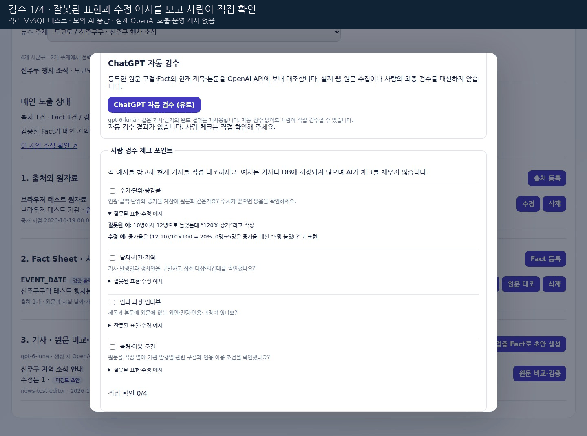

# ChatGPT 참고 검수와 사람 검수 포인트

**한 번에 시작하려면** 기존 서버 종료 후 `00_한번에_실행.bat`을 더블클릭한다. 준비 완료 후 관리자 화면이 열린다. [최신 시작 안내](../README_ONE_CLICK.md).

2026-10-20 추가. 관리자에서 기사를 읽으며 **등록 원문과 기사 자동 대조 → 사람이 네 포인트 직접 확인 → 검증 완료·저장**을 진행한다. ChatGPT는 검수 의견을 제공하고, 최종 검증·승인·공개는 사람이 처리한다.

## 1 기능정의서

| 기능 | 처리 |
| --- | --- |
| ChatGPT 자동 검수 | 관리자가 유료 버튼을 누른 경우에만 기존 `gpt-6-luna` 모델 호출. 제목·전체 문장과 등록 Fact·원문 구절 대조 |
| 항목별 결과 | 수치, 날짜·지역, 인과·과장·인터뷰, 출처·이용 조건을 일치·주의·불일치·판단 불가로 표시 |
| 문장별 근거 | 제목 포함 각 문장의 의견, 연결 Fact Key·출처 ID, 모델·사용량·요청자·시각 저장 |
| 사람 검수 | 네 확인 항목과 접이식 잘못된 표현·수정 예시. 직접 확인한 개수 표시, 자동 체크 없음 |
| 검증 저장 | 네 항목을 사람이 확인한 뒤 한 번에 문장 대조·승인·공개 저장. 일반 메모는 선택 |
| AI 불일치 처리 | 현재 검수 결과가 불일치라면 원문을 재확인한 처리 메모도 필수. 수정이 필요하면 새 수정본을 만든 뒤 다시 검수 |

자동 검수는 등록 구절을 비교하는 기능이다. 원문 URL을 열어 전체 웹문서를 수집하거나 외부 사실을 독립적으로 검증하지 않는다. 등록 자료의 오류도 사람이 확인해야 한다. 출처 이용 조건은 AI가 일치라고 답해도 사람이 확인하도록 표시한다.

## 2 화면구성과 사용 예시

`/admin` → **지역 뉴스** → 시군구·주제 선택 → 기사 **원문 비교·검증**을 연다.

1. 왼쪽 원문 구절과 오른쪽 기사 제목·본문을 읽고 원문 링크도 확인한다.
2. 필요하면 **ChatGPT 자동 검수 (유료)**를 누른다. AI 결과를 읽고 문장별 근거를 펼쳐 확인한다. 같은 기사·근거의 완료 결과는 다시 과금 요청하지 않고 재사용한다.
3. **사람 검수 포인트**의 예시를 펼쳐 읽고 직접 확인한 항목만 체크한다. AI 결과가 있어도 체크는 `0/4`에서 시작한다.
4. 네 항목을 확인하고 **검증 완료·저장**을 누른다. 현재 AI 결과가 불일치면 처리 메모에 재확인 결과도 기록한다.
5. 저장 후 목록으로 돌아가며 해당 시군구의 메인 지역 소식이 갱신된다. 공개 중단·새 수정본·행사일정 기능도 유지한다.

| 사람 체크 | 잘못된 예시 | 확인·수정 예시 |
| --- | --- | --- |
| 수치·단위·증감률 | 10명→12명인데 “120% 증가” | `(12-10)/10×100=20%`. 기준 0명→5명은 “5명 늘었다” |
| 날짜·시간·지역 | 10월 24일 종로 행사인데 발행일인 20일·중구로 작성 | 행사 날짜와 발행일을 구별하고 장소·대상·시간대 대조 |
| 인과·과장·인터뷰 | 행사 안내만 있는데 “경제가 살아났다”, “모두 만족” 추가 | 근거 없는 원인·전망·인용·과장을 삭제하고 확인된 내용만 작성 |
| 출처·이용 조건 | 링크 누락, 공개 자료이므로 전문 복사 가능하다고 판단 | 기관·발행일·구절·이용 조건을 직접 확인. 공개와 재사용 허가 구별 |

예시는 검수 방법 설명이며 실제 기사·Fact를 덮어쓰거나 샘플 승인 기록을 만들지 않는다. 문장마다 반복 체크하거나 별도 상태 변경·승인·게시 버튼을 누를 필요는 없다.



GIF는 실제 Node·FastAPI·격리 MySQL·브라우저 화면이며 **AI 응답은 모의 결과**다. 실제 유료 OpenAI 호출과 운영 게시를 시연한 영상이 아니다.

## 3 DB 설계와 API

**새 테이블·컬럼·SQL은 없다. 기존 DB에 SQL을 다시 실행하거나 자료를 초기화하지 않는다.**

| 저장 위치 | 기록 |
| --- | --- |
| `news_reviews` | AI 요청은 기존 `action=submitted`, `reason` JSON의 `kind=ai_assisted_review_v1`. 실행 중·완료·오류와 기사/Fact 해시·검수 결과 기록. 사람 승인과 구별 |
| `news_ai_usage` | 모델·요청 ID·입력/출력/캐시 토큰·성공/실패. AI 검수 JSON의 `usage_id`로 해당 사용량 연결. 비용은 자동 계산하지 않음 |
| 사람의 승인 이력 | `action=approved`, `reason.kind=human_guided_review_v1`. 네 체크, 메모, 현재 AI 검수 ID, 불일치 처리 메모 기록 |

브라우저는 기존 로그인·동일 출처·`X-News-Request: 1` 보호를 적용한 `POST /api/news/drafts/{id}/ai-review`를 사용한다. 요청은 `confirmation=RUN_AI_REVIEW`와 현재 `expected_content_hash`가 필요하다. FastAPI 내부 경로는 `/drafts/{id}/ai-review`다. 상세 조회는 `review_points`와 최신 `ai_review`를 반환한다.

새 화면의 `POST /drafts/{id}/verify-and-save`는 기존 `source_checked`, 해시, 선택 메모에 `human_checks` 네 항목을 전달한다. 현재 AI 불일치가 있으면 `ai_issue_note`도 필요하다. 구형 단일 확인 클라이언트는 호환하되 현재 AI 불일치 시 네 체크·처리 메모를 요구한다. 기존 상세 승인 API도 유지한다.

AI 요청은 DB 잠금을 풀고 실행한다. 응답 후 기사·근거 해시를 다시 확인하고 바뀌었으면 결과를 폐기하며 사용량·오류만 남긴다. 조회와 자동 검수는 문장 사람 검토·승인·공개 상태를 바꾸지 않는다. 자동 검수 이력과 사람 메모는 공개 피드로 내보내지 않는다.

## 4 데이터와 오류 처리

OpenAI에는 현재 기사·지역·주제, Fact 값·기간·단위와 필요한 원문 구절·이용 조건만 전송한다. 관리자 키·내부 토큰·사람의 비공개 검증 메모는 전송하지 않는다. 기존 직접 등록·CSV/JSON 수집과 한국 시간 16시 비공개 초안·노션 예약은 유지하며, 예약에 자동 검수·자동 승인을 추가하지 않는다.

| 상황 | 동작·조치 |
| --- | --- |
| 키 미설정·모델 권한 없음 | 가짜 성공을 만들지 않는다. 설정 후 재시작하거나 AI 없이 사람이 네 포인트 확인 가능 |
| 401·429·시간 초과·응답 형식 오류 | 안전한 오류 안내·이력 기록. SDK 자동 재시도 없음. 사용량 확인 후 필요할 때 직접 재요청 |
| 중복 클릭·다른 창의 요청 | 현재 실행 중 요청은 중복 호출 차단. 완료 결과는 같은 기사·근거일 때 재사용 |
| 실행 중 서버 종료 | 120초가 지난 실행 기록은 중단 오류로 정리하고 먼저 안내. 사용량 확인 후 별도의 다음 클릭으로 재시도 |
| 기사·근거 변경 | 예전 결과에 현재 기준 아님 표시. 새 수정본·현재 근거로 다시 검수 |
| 체크 누락 | 해당 기사 공개 저장을 거절하고 화면에 직접 확인 필요 안내 |
| AI 불일치 | 원문 재확인·수정본 검수 또는 처리 메모 기록 후 사람이 최종 결정 |

## 5 개발 환경과 실행·테스트

기존 Python FastAPI·MySQL·Node와 OpenAI SDK를 사용한다. `OPENAI_NEWS_MODEL=gpt-6-luna`, 본인의 `OPENAI_API_KEY`가 있어야 실제 호출할 수 있다. 키 설정 방법은 [상세 실행 안내](../README_AUTOMATION.md)를 따른다. 새 의존성·SQL·별도 예약 작업은 필요 없다.

기존 서버 두 창을 `Ctrl+C`로 종료 → 최신 파일을 기존 `package.json` 옆에 덮어쓰기 → **09_뉴스_서버시작.bat** → **19_뉴스_화면확인.bat**에서 8개 PASS·`20261020-review-1` 확인 → 관리자 **Ctrl+F5**. 기존 `.env`·`.venv`·DB를 유지한다.

```powershell
# 무료 기본 검증. API 키·유료 호출 없이 실행
.\.venv\Scripts\python.exe -m pytest tests/news/test_assisted_review.py tests/news/test_simple_review.py -q
npm run test:ui
npm run check
npm run docs:news:check
```

MySQL 통합·브라우저 실행은 [검증 보고서](../NEWS_TEST_REPORT.md)와 [녹화 재현 안내](SCREEN_RECORDING.md)를 따른다. 테스트 전용 DB만 사용한다.

수동 확인 항목: 키 없을 때 안내, 유료 버튼을 눌렀을 때만 호출, 제목·모든 문장 결과 저장, 결과 재사용, AI 후에도 사람 체크 0/4, 예시 펼치기, 일부 체크 저장 차단, 불일치 처리 메모, 새 수정본에서 이전 결과 미상속, API 오류 후 수동 검수, 저장 후 해당 시군구 기사 표시, 공개 중단·한국/일본·모바일.
